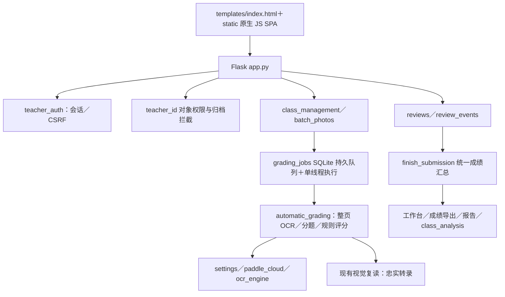

# TRANSLATION-AI-IMPLEMENT-01-AUDIT：现状审查

日期：2026-11-23。范围：PHASE 0。状态：审查完成，技术设计另见同编号 DESIGN；尚未获准实施。

## 1. 审查结论

当前项目具备可复用的账号隔离、OCR、分题、后台队列、教师改判和成绩出口，适合增量扩展高中英语中译英评分。**但现有“句子翻译”标签不代表已经具备语义评分；当前核心仍是严格文本匹配。**

必须先处理三个贯穿全流程的问题：

1. 增加明确的翻译评分模式、中文原文和版本化细则，旧题不自动切换评分方式。
2. AI 建议记录与教师最终分分离；OCR 完成、AI 完成、成绩确认是三件不同的事。
3. 所有列表、统计、导出、讲评和打印共同遵守“未确认不算最终成绩”，不能只修详情页。

不需要换 Flask／SQLite，不需要第二套后台任务框架，也没有证据要求引入向量库、模型训练或大型前端依赖。本轮仅研究与写文档，没有操作数据库或部署环境。

## 2. 代码基线与方法

| 基线 | 本次使用方式 |
| --- | --- |
| 本地分支 feature/mp-02a-teacher-accounts | 当前开发基线，不切分支 |
| 本地 HEAD f9279867416d53df3c76decc3f8e9aa1e3188cae | 同时读取工作区既存未提交改动，不能只看 HEAD |
| GitHub 8c3c46e74e024ba0eaced1d7b46b14785952dd1d | 下载固定源码归档核对远端，未 checkout、commit 或 push |
| 既有 TRANSLATION-RESEARCH-01.md | 复用 DiscoX／Rubric-MQM 的源码研究和上轮探针结果 |
| 本轮开源研究 | 补查 Translation Error Grounding／TranslationCorrect，形成独立四项目报告 |

本报告的默写本行号指本地本轮快照，后续编辑会发生偏移；函数名是长期定位依据。未读取 `.env`、settings 实际密钥、学生照片或业务数据库，没有通过 create_app 启动应用（它包含初始化／迁移行为）。数据库结构从建表和迁移**源码**审计，不能当作已对正式库执行 PRAGMA 检查。

本地已有 app.py、settings.py、grading_jobs.py、static/app.js、static/workspace.js 等未提交改动，以及若干既有未跟踪文档，均应保留。本地取消了旧的单次 8 题复核限制，并存在整页后台复读；远端固定版本仍有旧额度路径。两处均未发现本任务所需的翻译语义评分模块。

## 3. 项目真实形态

前端不是 React／Vue 工程，没有本任务需要的独立 frontend 构建层。已有 public 图片路径等历史描述不应覆盖实际 static／templates 结构。依赖分为本地 requirements.txt 和云端 requirements-server.txt；翻译设计不新增依赖。

## 4. 功能与证据清单

| 审查项 | 已验证代码位置 | 现状／缺口 |
| --- | --- | --- |
| 应用入口和持久化 | app.py:create_app:92，数据库路径:122；production.py、wsgi.py | Flask＋SQLite，可复用；本轮未启动 |
| 题目结构 | app.py:215—218；word_import.py:migrate_word_fields:18 | questions 有 kind／answer／variants／points，迁移补 context／hint；无显式翻译模式和细则版本 |
| 创建题目 API | app.py:new_task:683—718 | kind 仅 word／phrase／sentence／grammar；context 是可选上下文，不能自动推定为中文源文 |
| 创建页面 | static/app.js:answerRow:410、renderNewTask:492、createTask:501 | 现有表格和校验可扩展；页面当前明确宣告精确匹配、否则零分 |
| Word 导入 | word_import.py:parse_word:55、parse_answer_word:121；翻译标题映射:111—113 | 能识别“半句／整句翻译”分组，不等于能生成语义细则；不自动把旧导入改成 AI 评分 |
| OCR 主流程 | automatic_grading.py:ocr_page:121、region_ocr:162、auto_grade:250 | 云 OCR／本地 OCR 调用、图片证据、失败状态可保留 |
| 答案提取 | app.py:suggestions_for:1461；answer_extraction.py:card_candidates:25、grammar_candidates:121 | 明确题号分题可用；卡片候选合并空白，多栏／跨页长句仍需针对性测试 |
| 原始证据保护 | automatic_grading.py:persist_candidates:64—92；pages／ocr_runs／reviews | 保留 OCR 和识别历史、保护 teacher_edited；翻译不能让 AI 改写原答案 |
| 规则评分 | grading.py:normalize:6、compare:10；app.py:RULES | 合并空白后严格比较，区分大小写、标点和顺序；SequenceMatcher 只用于差异展示 |
| 成绩唯一汇总 | app.py:finish_submission:529—563 | 全题走 compare；无 override 时满分或零分；需要按评分模式分支 |
| 结束状态 | automatic_grading.py:auto_grade:359；app.py:finish_submission:554 | OCR／自动评分后设 final；加入翻译后不得据此直接宣布教师最终成绩 |
| 模型请求封装 | settings.py:_chat:105—142 | 受控 HTTP、禁重定向、超时、2MiB 响应限制；**固定附带图片**，不宜直接伪造图片调用文本评分 |
| 当前视觉复读 | settings.py:reread_page:214、reread_handwriting:250／短答解析:239、268；app.py:automatic_ai_review:1010 | 用于忠实转录，不传参考评分；限制 160 字符／20 词及短答题型，不能冒充翻译评分器 |
| AI 建议表 | app.py:visual_suggestions:240—247 | 强制 page_id／图裁范围和复读语义；不适合装文本翻译评分结果 |
| 后台队列 | grading_jobs.py:GradingJobs:109、enqueue:160、run_next:251、grade:349、ai_review:373 | 现有持久游标、身份、去重与中断机制；复用并加翻译阶段 |
| 教师保存 | app.py:save_review:1331—1416 | 有事务、分数上下界、理由、before／after 历史；需要翻译确认分支和结构化分项元数据 |
| 撤销与历史 | app.py:undo_quick_review:1420、history:1617 | 撤销只支持约定 action，不是任意改判都能自动撤销；需显式扩展 |
| 异常汇总 | teacher_workbench.py:submission_attention:10、attention_snapshot:72 | 已共用统计快照；异常按失败／未批改／识别不确定，尚无“翻译建议待确认” |
| 班级名单和均分 | class_management.py:assignment_detail:124—163 | final_scores 来自 is_final；必须把翻译确认状态纳入 is_final |
| 导出 | class_management.py:grade_rows:693、assignment_grades:703、assignment_grades_xlsx:717；app.py:grades:1553 | 共用行生成可复用；任务 CSV 也需处理 pending，不能漏改 |
| 讲评和报告 | class_analysis.py:build:13—73；app.py:report:1611；templates/print.html | 比较 score 与 points、分组错题、模板数值格式均需审计空值 |
| 导航与草稿 | static/navigation.js:restore:39、mayLeave:57 附近、popstate:153；static/app.js:reviewDraft:624 | 现有来源返回、草稿离开保护可复用；需纳入翻译草稿，不能另写一套返回机制 |
| 备份／删除 | backup_data.py:backup:34、verify:55、restore:72；task_deletion.py:delete_task:46 | 已有 SQLite backup＋图片哈希验证；新表需进入本地删除依赖，生产永久删除仍受限制 |

## 5. 业务链路中的关键断点

### 5.1 翻译题目前会怎样得分

当前 kind=sentence 只改变题目标签，不切换算法。学生答案表达正确但不同于 answer／variants 时，compare 仍会返回不匹配，finish_submission 将其算为零分。它符合当前默写严格规则，**不是可以通过放宽 compare 修复的翻译小问题**；放宽共享 compare 会破坏单词和语法填空。

方案应新增 scoring_mode，默认 strict；仅教师新建时明确选择“中译英 · AI 建议评分”的题走新流程。既有 sentence、phrase、grammar、word 和历史导入保持 strict。

### 5.2 OCR 复读与翻译评分不能混用

视觉复读回答“纸上写了什么”，应不知道标准答案，以免无意纠错。翻译评分回答“这个答案表达了多少语义、有何语言错误”，必须接收中文、参考、细则和答案。可以共用平台的模型连接与密钥管理，不能共用同一个业务提示词或让评分器改写 OCR。

现有 card_candidates 会合并空白；新评分结果应锚定**提取完成后冻结的答案快照**，同时保留更底层 OCR 块和原图。这里不能许诺还原 OCR 未记录的原始字符排版。跨页断句、题号歧义和识别冲突标为 OCR 风险，不能把“看不清”扣成学生语言错。

### 5.3 建议分不应偷偷参与总分

仅往 reviews.score_override 写模型分不可接受：它既污染正式成绩，又丢失 AI／教师边界。设计为独立 AI 表追加记录；教师确认后事务写入 reviews 最终分和 review_events。未确认时 final_score 为 null，列表显示“待教师确认”，统计不计均分，导出分数留空并附状态，讲评不列为确定错题。

mixed 作业中已有严格题仍可显示机器得分，新增 known_score 表示已确定部分；不得把该小计伪装成整份最终总分。所有调用 finish_submission 的列表和模板都要一起验证。

### 5.4 任务恢复不能重复计费或覆盖教师

现有 grading_jobs 使用 SQLite 游标和单执行线程，并通过 internal_post 传 owner_id；复用这些机制。新流程需要细化到“答卷＋题目＋答案快照＋细则版本”的尝试记录。外部请求前持久化 attempting；断电后不盲目重发。成功数据落库和游标前进尽量同一事务；若结果已在库，恢复只复用。

教师已确认的题默认跳过；显式重评也只追加 AI 历史，不更新教师最终分。模型在途时教师改了转录、细则或归属，迟到结果只能留作历史，不得成为当前可采纳建议。

## 6. 安全、权限与归属

| 层级 | 已有依据 | 翻译扩展必须补齐 |
| --- | --- | --- |
| 登录和会话 | teacher_auth.py:teacher_gate:145 | 新页面与 API 均不能加入匿名白名单 |
| CSRF／Origin | teacher_auth.py:check_csrf:175；app.py:158—180 | 所有生成、重试、采纳、改判接口继续检查；GET 无业务写入或云端调用 |
| 教师端点白名单 | app.py:tenant_route_guard:346—377 | 新路由显式加入；禁止为省事移除保护 |
| 资源权限 | app.py:row:471—484 | questions 本身不在直接 owner 表集合；必须通过 task 验权，AI 记录通过 submission 验权，再验证两者同任务 |
| 数据库关联 | app.py 的 owner 约束／触发器；reviews 复合主键 | 新表继承父对象所有权，防止同教师跨作业拼 ID；不能只做“属于这个老师” |
| 后台身份 | grading_jobs.py:run_next:270—285；teacher_auth.py:internal_post:24 | 新 task 级细则任务也要持久 task_id 和 owner，执行前复验禁用／归档 |
| 归档 | app.py:archived_assignment_read_only:380 | 同时保护新 job、细则修改和最终确认；已归档作业只读查看历史版本 |
| 文件和导出 | row／父级链验证和已有文件接口 | 翻译界面沿用受保护图片 URL，不能生成公开磁盘／静态资源地址 |
| 模型秘密 | settings／production 出站白名单与平台配置 | 普通教师不得改地址／Key，结果 DTO 不含提示词密钥或供应商异常原文 |

本轮没有做渗透测试或正式环境全路径验证，不能把“保护代码存在”称为全部权限验收通过。

## 7. 可以保留与必须新增

**原样保留的业务规则**：strict-v1、现有正确变体、身份归属、学生和班级 owner、图片证据、现有云 OCR 主架构、注册登录、既有导航契约。

**可扩展复用的基础设施**：题目创建表单／API、受控模型传输、grading_jobs、reviews／review_events、工作区和草稿保护、成绩汇总与导出、备份工具。

**需要新增的能力**：中文源文和显式评分模式；题目细则生成／调整／版本；翻译分析 JSON 校验；程序按细则计分和去重归因；AI 历史表；班级翻译总览及集中复核；单题分项与错误编辑；确认事务；翻译状态和全部成绩出口的空值规则；迁移／回滚脚本与测试。

不新增用户角色、学生端、开放注册策略、第三方后台服务或独立前端框架。不自动改旧任务评分模式。

## 8. 当前测试基础与本轮验证

静态 AST 扫描发现 28 个 test_*.py 文件、333 个 test_ 开头的方法定义；**这是源码清点，不是 unittest 收集数或通过数**，继承、参数化、跳过等会使实际数量不同。现有浏览器检查脚本还覆盖导航、草稿保存、批改、成绩、讲评和归档。

优先复用的测试：

- test_app.py、test_auto_grade.py、test_ocr_alignment.py：严格规则、OCR／分题和历史保护。
- test_grading_jobs.py、test_ai_review.py、test_settings.py：后台去重、恢复、模型故障、在途结果。
- test_tenant_isolation.py、test_archive_security.py、test_teacher_auth.py：双教师、归档、鉴权。
- test_classes.py、test_class_analysis.py、test_teacher_workbench.py：名单、均分、讲评和异常口径。
- scripts/check_save_review_drafts_flow.cjs、check_review_navigation_ui.cjs、check_progress_polling_ui.cjs 等：草稿、返回和轮询。

本轮实际执行：只读源码与远端归档核验、AST 清点、公开数据文件统计、文档完整性与工作区差异校验。没有运行应用测试、OCR／模型测试或浏览器回归。PHASE 3 必须在隔离临时数据库、虚构教师和学生下执行全部适用回归，记录真实运行数／通过／失败／跳过与原因。

## 9. 实施风险排序

| 优先级 | 风险 | 必须采取的措施 |
| --- | --- | --- |
| P0 | 翻译未经教师确认已算入成绩 | 共享汇总按 scoring_mode 分支；全部出口验证 pending=null |
| P0 | AI 覆盖教师成绩或学生原答 | AI 独立追加记录；确认专用事务；版本／修订校验 |
| P0 | 跨教师／跨作业取 AI 记录 | 父对象验权＋复合外键／同任务检查＋双教师测试 |
| P0 | 更新代码触发真实库迁移或不可安全回滚 | 显式迁移、隔离演练、备份校验、无损回滚边界先批准 |
| P1 | 合理不同译法被误扣、同根因重复扣分 | 无错允许、判定证据、计分归因约束、教师标注基准集 |
| P1 | OCR 错误被当成学生错误 | 独立 OCR 风险，禁止风险答案直接一键采纳 |
| P1 | 生成细则在班级之间变化 | 题目版本固定、任务快照，编辑后追加版本不覆盖历史 |
| P1 | 任务重复提交／超时重发计费 | 幂等键、持久尝试、未知状态人工重试、有限超时 |
| P1 | 新状态让名单、导出、打印崩溃 | 空值／混合题型／归档／离线报告回归 |
| P2 | 成本和教师节省时间未知 | 小规模授权试验后再优化并发与提示词 |
| P2 | 第三方数据许可不明 | 首版不复制代码和数据，使用自建合成测试集 |

## 10. PHASE 0 出口与下一步

已形成“现有能力／缺口／文件位置／风险”审查证据，四项目结果见 `TRANSLATION-OPEN-SOURCE-RESEARCH-01.md`。PHASE 1 设计必须同时覆盖 schema、迁移回滚、状态、计分、API、UI、后台和测试，不能将其中任一项留给实现时临时猜测。

在产品负责人确认 DESIGN 前，停止在文档交付阶段。当前不能声称翻译批改已可使用，也不能给出准确率、成本或上线日期承诺。
