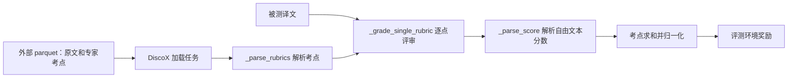
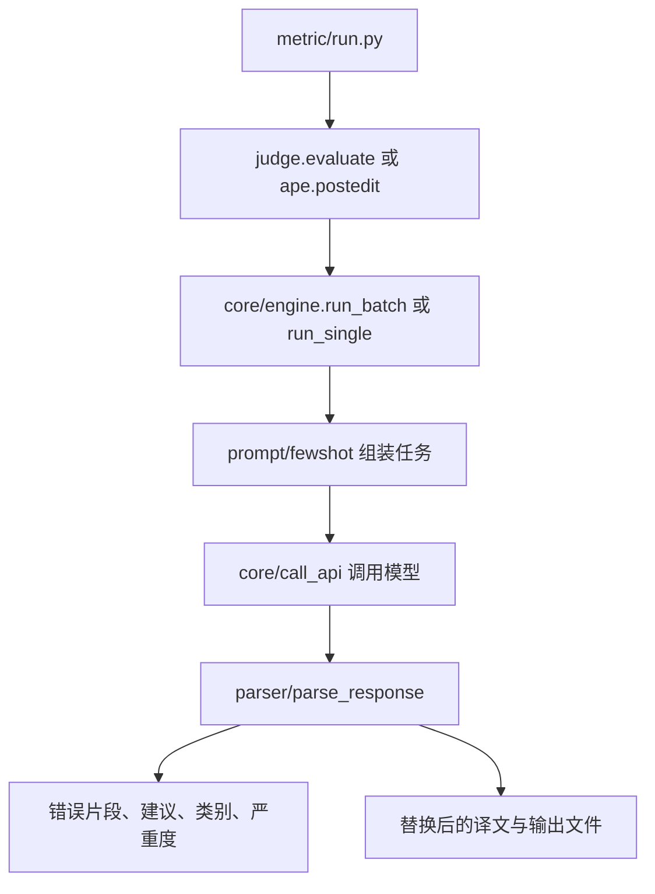
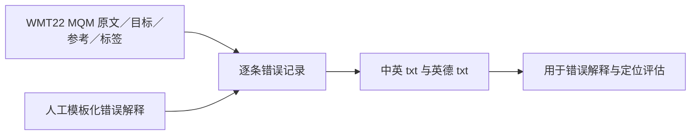
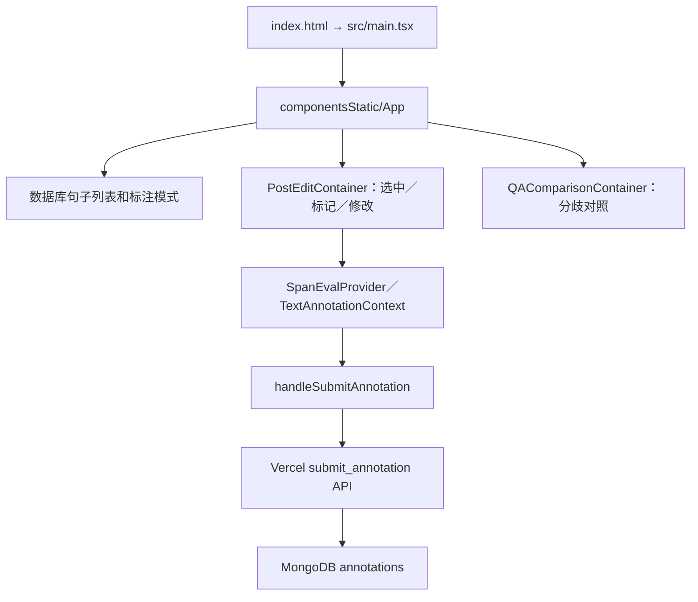
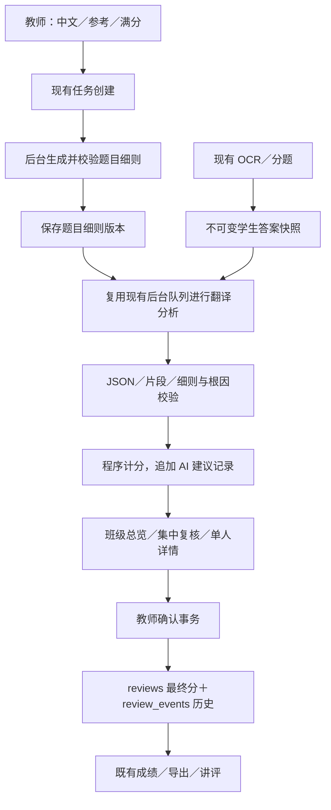

# TRANSLATION-OPEN-SOURCE-RESEARCH-01：翻译智能批改开源研究

研究日期：2026-11-23。阶段：PHASE 0／PHASE 1 的研究输入。结论状态：待产品负责人审核，未实施。

## 1. 结论与证据边界

建议采用四个项目的设计思想，**不把任何一个项目整体引入默写本**：DiscoX 提供题目级考点思路；Rubric-MQM 提供错误诊断思路；Translation Error Grounding 提供原文、译文、片段和解释的关系；TranslationCorrect 提供片段标记、修改和复核交互。四者都不是可以直接接入现有教师成绩系统的完整解决方案。

本轮实际读取固定版本 README、目录和关键源码／数据，检查 LICENSE 和依赖声明。没有安装四项目依赖，没有启动其在线应用，没有向其服务提交数据，没有调用收费模型。不能据此声称实际评分准确率或完整运行成功。对 DiscoX、Rubric-MQM 的详细源码分析复用本仓库既有 `TRANSLATION-RESEARCH-01.md`；本文扩展为四项目并服务于本轮设计。

| 项目 | 固定提交 | 实际核验范围 | 运行边界 |
| --- | --- | --- | --- |
| [DiscoX](https://github.com/EnvCommons/DiscoX/tree/4784e77536bf7596f63c5883993e5bc55d472509) | 4784e77536bf7596f63c5883993e5bc55d472509 | discox.py、server.py、README、Dockerfile、requirements、数据说明和样例 | 上轮执行过提取纯函数的离线探针；未运行完整环境 |
| [Rubric-MQM](https://github.com/trotacodigos/Rubric-MQM/tree/b210d0afe3df6b3eda9f6c46604bc15f81abb13a) | b210d0afe3df6b3eda9f6c46604bc15f81abb13a | metric CLI／engine／API／parser／prompt／包装层、v1 提示词、LICENSE、requirements | 上轮执行过模拟边界探针；未运行完整模型流程 |
| [Translation Error Grounding](https://github.com/Ssjoo02/translation-error-grounding/tree/cd3819f3cee0a85defffabf5025fa43babd6d2a5) | cd3819f3cee0a85defffabf5025fa43babd6d2a5 | 全部三个文件：readme.md 和两个语言方向的数据文件 | 本轮读取全部数据并统计，不是运行模型 |
| [TranslationCorrect](https://github.com/MekaelWasti/TranslationCorrect/tree/37cc7dbd0536cc37b0fef939385e0e3b5d531e32) | 37cc7dbd0536cc37b0fef939385e0e3b5d531e32 | README、LICENSE、package／lock、HTML／main、活动组件、Context、保存和登录 API、数据说明 | 静态调用链核验；没有安装、构建、访问其在线数据库 |

事实、建议和待验证事项在下文分别表述。源码支持“有此处理路径”，不等于该路径无缺陷，也不等于它适合高中考试。

## 2. DiscoX：逐考点评价

### 2.1 架构与真实数据

数据包含 `ori_text / prompt / reference_list / Primary_Domain / Secondary_Domain / prompt_id`。`reference_list` 是专家考点文本，不是“一个正确答案字符串的数组”。仓库依赖外部 parquet，模块导入时即尝试加载；缺数据时不能直接运行。

核心证据：[discox.py](https://github.com/EnvCommons/DiscoX/blob/4784e77536bf7596f63c5883993e5bc55d472509/discox.py)、[server.py](https://github.com/EnvCommons/DiscoX/blob/4784e77536bf7596f63c5883993e5bc55d472509/server.py)。

### 2.2 核心函数

| 函数／位置 | 已实现行为 | 对默写本的意义 |
| --- | --- | --- |
| `_parse_rubrics`，128—171 行 | 按“考点N：”或编号拆分已有专家细则；每项默认 1.0 分 | 借鉴“有稳定 ID 的语义点”；**没有自动生成题目细则的功能** |
| `_grade_single_rubric`，222—259 行 | 每个考点单独请求模型，返回分析和 0—1 得分 | 可借鉴按点提供证据；不照搬每个点一次请求 |
| `_parse_score`，195 行起 | 自由文本正则和兜底数值解析 | 不采用；无关数字可能成为得分，缺分可能归零 |
| `_grade_all_rubrics / submit_translation`，261—295 行 | 并发各考点，求和后按总权重归一化 | 借鉴程序汇总；不采用无界并发和异常归零 |

它能否接受合理的不同译法，取决于考点和模型判断；没有独立的语义等价证明器。所谓“专家细则生成器”不是已验证现成功能。

### 2.3 推荐与排除

采用：同一道题共用版本固定的得分点；逐项给证据；评分结果可追溯到细则。

排除：所有考点统一等权、专业领域权重、模型名称硬编码、从任意文本猜分、调用失败记零、把评测 reward 直接当考试分。默写本按题生成可调整的权重，一次答案分析返回全部考点判断，服务端按离散档位计分。

## 3. Rubric-MQM：错误诊断与结构化输出

### 3.1 架构

源码：[engine.py](https://github.com/trotacodigos/Rubric-MQM/blob/b210d0afe3df6b3eda9f6c46604bc15f81abb13a/metric/core/engine.py)、[fewshot.py](https://github.com/trotacodigos/Rubric-MQM/blob/b210d0afe3df6b3eda9f6c46604bc15f81abb13a/metric/prompt/fewshot.py)、[parse.py](https://github.com/trotacodigos/Rubric-MQM/blob/b210d0afe3df6b3eda9f6c46604bc15f81abb13a/metric/parser/parse.py)。提示词使用 Git LFS；本轮沿用上轮已下载并校验 SHA-256 的实际提示词内容，未把 LFS 指针误认为内容。

### 3.2 真实能力与缺陷

- 输入原文、目标译文、可选参考、领域和少样本示例，由 LLM 作为评审者判断问题；不是传统词对齐模型。
- 当前 v2 模板包含 addition、mistranslation、omission、grammar、word order 等类别，严重度 1—4；旧版 DR100 使用另一套尺度，两者不可混用。
- **当前两条 v2 模板都要求至少找出一个问题**。这与“正确译文可无错误”直接冲突，不能用于学生判分提示词。
- 输出以错误文本作为 JSON 对象的键；重复片段无法可靠区分位置，也不适合表达空白处遗漏。
- `parse_response` 缺少严格 schema、类别、范围和片段校验；无效 JSON 有返回 success=true 和空错误的路径，不能等同于“确认无错”。
- 对空替换文本、单字符等情况有丢弃路径；直接做替换会混淆学生答案与修改稿。

上轮离线探针还复现了无关数字计分、JSON 解析、换行丢失、模板花括号、包装层返回契约和进程池局部函数等问题，详见既有报告第 10 节验证记录。本轮未重跑完整系统，不把这些探针称为线上模型实验。

### 3.3 高中教学适配

推荐错误大类：语义偏差、信息遗漏、逻辑关系、语法、词汇、搭配、句法、拼写；以子类表示时态、主谓一致、从句、非谓语、否定等知识点。严重度用“轻微／明显／关键”，具体扣分由**当前题目细则**确定，不能统一采用专业 MQM 扣分表。

明确允许 `errors: []`。模型必须说明哪条原文语义未表达或哪项语言规则不满足；仅“与参考措辞不同”不得成为扣分理由。参考译文是例子，教师明确要求的词或句式才是约束。

同一根本错误用一个 `root_cause_id` 表示，归入一条可计分细则；其他观察可作为不扣分提示。跨语义和语法的重复扣分不能靠提示词保证，必须通过服务端的扣分归属约束防止。模型对于“是不是同一根因”的判断仍需教师和基准集验证。

## 4. Translation Error Grounding：定位数据与测试集

### 4.1 真实结构

固定版本只有 `readme.md`、`data/zhen/mqm_zhen.txt`、`data/ende/mqm_ende.txt`，没有模型评分引擎、UI、服务 API 或依赖清单。

每条是多行记录，字段为 `source / target / reference / category / severity / explanation`，目标文本中以 `<v>...</v>` 标记片段，**不是已经给出 start/end 数字偏移的 JSON**。README 说明除 explanation 外源于 WMT22 MQM，解释由人工按模板补充。证据：[readme.md:8—35](https://github.com/Ssjoo02/translation-error-grounding/blob/cd3819f3cee0a85defffabf5025fa43babd6d2a5/readme.md#L8-L35)、[中英数据](https://github.com/Ssjoo02/translation-error-grounding/blob/cd3819f3cee0a85defffabf5025fa43babd6d2a5/data/zhen/mqm_zhen.txt)。

### 4.2 本轮实际数据统计

按行首 `source:` 分割记录，保留多行字段；按去除 `<v>` 的目标译文与原文联合去重。结果：

| 指标 | 中英 zhen | 英德 ende |
| --- | ---: | ---: |
| 错误记录条数 | 1080 | 954 |
| 不同的原文＋目标译文组合 | 585 | 588 |
| minor | 552 | 748 |
| major | 528 | 206 |
| 无 `<v>` 配对片段的记录 | 79 | 20 |
| 有标记片段、但该文字在去标签译文中出现多次的记录 | 168 | 105 |

这些是**错误记录数，不是独立学生数或题数**。无 `<v>` 的记录包含 omission；没有现成片段不能一概判为脏数据，遗漏本来可能只对应一个插入位置。重复文字说明不能用 `find(片段)` 默认第一处来定位。数据统计只验证格式性质，不代表评分准确率。

### 4.3 适合默写本的数据约定

- `source_text` 保存中文；`reference_text` 保存教师参考；`answer_snapshot` 保存本次分析的学生文本；三者独立。
- 原始 OCR 和教师修订转录分别保留。AI 修改建议只保存为建议，不覆盖其中任意一份原文。
- 错误使用稳定 ID、学生片段 start/end、原文片段 start/end、类型、严重度、解释、建议、知识点和细则 ID。
- start/end 以 **Unicode 码点、左闭右开** 定义；校验 `answer[start:end] == student_segment`。重复文字按明确偏移区分，不能模糊匹配到第一处。
- 信息遗漏允许 `start=end`、空 student_segment，并提供有效的原文片段和插入锚点；这不是虚构已有学生文字。
- 换行、空格和弯引号均保留，不能先标准化再把位置应用到原文本。

### 4.4 评估集应该怎样建立

首版使用教师授权的自建虚构答案集，不下载学生真实信息，也不把该数据集直接打包到产品。每题准备正确译文、多种合理译法、单一错误、多个独立错误、一个根因多种表象、OCR 干扰和空答等样本。建议首轮 12 题、每题至少 8 种答案、至少 96 份答案；这是计划目标，当前未完成标注或模型实验。

由两位教师独立标注语义点、错误位置／类型、合理得分区间，再协商分歧。划分按**题目／原文**进行，同一句的不同错误不能同时进入开发集和留出集。必须补充正常无错样本，避免只有错误样本导致模型“总要找错”。

指标包括：有效片段比例、完全匹配 span precision/recall/F1、字符重叠 F1、遗漏锚点单独命中率、类型／严重度一致率、合理译法误扣率、分数 MAE、教师确认／修改耗时。位置正确与判分正确分别测；不能因为有合法偏移就宣称语义判断正确。

## 5. TranslationCorrect：复核交互

### 5.1 实际入口与架构

实际入口为 [main.tsx:1—19](https://github.com/MekaelWasti/TranslationCorrect/blob/37cc7dbd0536cc37b0fef939385e0e3b5d531e32/frontend/src/main.tsx#L1-L19)。未把旧 `App copy.tsx`、旧 ReactDOM.render 入口或全注释的 `components/HighlightText.tsx` 当作活动实现。`PostEditContainer` 自己实现了活动文本编辑／叶节点渲染；另一个 `postEdit/HighlightedText.tsx` 虽有组件实现，也不能只因文件存在就认定主页面使用它。

### 5.2 真实实现与 README 宣传的区别

| 功能 | 实际源码证据 | 结论 |
| --- | --- | --- |
| 原文／译文和句子列表 | componentsStatic/App.tsx、scoring/DatabaseSentenceView.tsx | 有实现 |
| 文本差异、错误标记、分类／严重度修改和删除 | PostEditContainer.tsx 的 generateDiff、updateSpansForTextChange、renderLeaf；SpanEvalProvider 的增删更新函数 | 值得借鉴交互概念 |
| 标注与 QA 对比 | qa/QAComparisonContainer.tsx、util/qaComparisonUtils.tsx 的 getSpanDiffs | 有人工分歧对照结构 |
| 总分和片段评分 | ScoringContainer、OverallScoreSlider 文件存在；活动 App 432 行起的 ScoringContainer 渲染被注释 | 不能宣称主流程已启用完整评分界面 |
| 保存并转到下一句 | App.handleSubmitAnnotation 165 行起，POST 至 submit_annotation；成功后选下一条 | 有实现；边界与幂等性仍需改善 |
| NMT→检测→训练反馈闭环 | README 描述并引用另一 TranslationCorrect-V2 仓库资源 | 本次指定仓库内未验证完整闭环，不作为可复用后端 |
| 教师成绩导出 | 本轮活动链路未发现完整对应实现 | 不假设已有；默写本复用自己的导出 |

核心源码：[App.tsx](https://github.com/MekaelWasti/TranslationCorrect/blob/37cc7dbd0536cc37b0fef939385e0e3b5d531e32/frontend/src/componentsStatic/App.tsx)、[PostEditContainer.tsx](https://github.com/MekaelWasti/TranslationCorrect/blob/37cc7dbd0536cc37b0fef939385e0e3b5d531e32/frontend/src/componentsStatic/postEdit/PostEditContainer.tsx)、[SpanEvalProvider.tsx](https://github.com/MekaelWasti/TranslationCorrect/blob/37cc7dbd0536cc37b0fef939385e0e3b5d531e32/frontend/src/componentsStatic/SpanEvalProvider.tsx)、[types.ts](https://github.com/MekaelWasti/TranslationCorrect/blob/37cc7dbd0536cc37b0fef939385e0e3b5d531e32/frontend/src/types.ts)。

### 5.3 不能照搬的部分

- 技术栈为 React18／Vite／TypeScript／Slate，加 Vercel API 和 MongoDB；默写本为 Flask＋原生 JS＋SQLite，引入整套会造成两套系统。
- 活动组件 import react-toastify，但 package.json 只直接列其类型包；lock 中实际存在运行包。结论是依赖声明需核验，**不是已经复现构建失败**。
- 文本编辑后移动 span 的代码复杂且使用 JS 字符串索引；默写本应锚定不可变答案快照，不让修改建议改变原文坐标。
- submit_annotation.ts 从请求接收 dataset 和动态标注键，允许 CORS *，未见默写本所需的会话、CSRF 和教师对象权限检查；绝不能替换现有鉴权。
- 保存 API 用 modifiedCount 判断成功，同样内容再次保存可能被视为失败；默写本需要幂等键。
- App 保存成功后自动选下一句，随后在 nextSentence 判空区块之外仍访问它，存在尾项边界风险；不能照搬“保存即无条件跳下一条”。
- 颜色很多、部分操作依赖悬停／右键。默写本需文字类别、可聚焦的错误列表、点击／键盘支持和手机可用入口。

### 5.4 推荐的教师复核方式

同一题的答案列表上直接展示语义缺失、关键错误、建议分与确认状态，先看风险而非按低分排序；每行可展开证据、采纳或进入详情。详情中“学生原答”和“建议修改稿”分开，错误片段与解释互相定位。教师可标记“此处无错”或调整类型／严重度，系统按所选细则重新算建议；最终保存必须是明确的教师动作。

首版不引入富文本编辑器；用转义文本、mark 和按钮完成标记，用表单调整分项／说明。采用现有离开保护，保存成功才进入下一位，失败保留草稿、图片位置和焦点。集中复核不等于未经查看一键接受全班。

## 6. 许可证与商业集成边界

| 对象 | 已核验许可信息 | 商业产品处理建议 |
| --- | --- | --- |
| Rubric-MQM | 独立 MIT LICENSE，Copyright 2025 Ahrii | 实质代码／提示词复用时保留版权和许可通知；本轮不复制 |
| TranslationCorrect | 独立 MIT LICENSE，Copyright 2025 Mekael Wasti | 同上；代码许可不自动解决其外部数据许可 |
| Translation Error Grounding | 当前归档及 GitHub 元数据未见明确许可证 | 未获许可前不将文本、人工解释或数据集打包、训练或再分发；只参考结构思想 |
| DiscoX | README 声明 CC-BY-4.0；代码归档未见独立 LICENSE，GitHub 检测为 null | 不据此认定禁止一切，也不认定代码授权已无歧义；实质集成前确认覆盖范围与署名要求 |
| DiscoX 数据、WMT 来源、FLORES+／合成数据 | 分别有上游来源，许可不能由根仓库推定 | 如未来使用，逐一记录来源、具体版本、商业使用／署名／再分发条件 |

许可证据：[Rubric-MQM LICENSE](https://github.com/trotacodigos/Rubric-MQM/blob/b210d0afe3df6b3eda9f6c46604bc15f81abb13a/LICENSE)、[TranslationCorrect LICENSE](https://github.com/MekaelWasti/TranslationCorrect/blob/37cc7dbd0536cc37b0fef939385e0e3b5d531e32/LICENSE)、[TranslationCorrect 数据来源说明](https://github.com/MekaelWasti/TranslationCorrect/blob/37cc7dbd0536cc37b0fef939385e0e3b5d531e32/Annotation%20Data/README.md)、[DiscoX README](https://github.com/EnvCommons/DiscoX/blob/4784e77536bf7596f63c5883993e5bc55d472509/README.md)。

本轮没有引入第三方运行依赖，因此没有新增产品依赖的许可变更。若后续改变“不复制”的决策，必须检查确切引入包及其传递依赖、数据和提示词许可，不能以“根项目 MIT”替代供应链检查。本表是工程许可核验记录，不是法律意见。

### 6.1 依赖与运行要求核验

| 项目 | 依赖／运行要求（来自实际文件） | 本轮判断 |
| --- | --- | --- |
| DiscoX | requirements列fastapi、uvicorn、openreward、openai、pandas、pyarrow、pydantic、datasets；Dockerfile使用Ubuntu22.04和Python3.11，另需外部parquet与模型配置 | 运行环境明显大于默写本所需；未安装或构建，不整体引入 |
| Rubric-MQM | requirements仅列openai==2.14.0、tenacity、pyyaml；源码另外使用pandas／tqdm，提示词需实际LFS内容和接口配置 | 新环境依赖声明不闭合；只借鉴思想，不以“pip可装”当完整可运行 |
| Translation Error Grounding | 三个数据／说明文件，没有requirements或可执行模型入口 | 用标准库即可读取格式；不存在可运行的现成评分服务 |
| TranslationCorrect | package scripts为vite开发、tsc＋vite build；React18／TypeScript／Slate、MongoDB与Vercel API；后端需Mongo连接环境变量，部分请求写死外部服务地址 | 未安装构建／登录；不借其后端，当前依赖无需加入默写本 |

四项目的完整依赖供应链许可没有被宣布审核通过，因为本方案不引入它们的运行代码或依赖。若以后要复用，需按确切版本及锁文件逐包核验；现有MIT根许可只覆盖其明确授权的内容，不能替代依赖／数据许可审查。

## 7. 与默写本的融合对照

| 参考项目 | 借鉴内容 | 默写本对应模块 | 是否直接采用 |
| --- | --- | --- | --- |
| Rubric-MQM | 分类、严重度、局部解释与建议 | 新 translation_grading.py 的答案分析与严格校验 | 只采用思想，重写提示词和校验 |
| Translation Error Grounding | 原文／目标／参考、片段和解释 | AI 记录 JSON、定位校验、合成回归集 | 结构思想采用；不引入原数据 |
| TranslationCorrect | 错误可视化、人工纠正、分歧复核 | 现有工作区＋单人详情内的翻译复核组件 | 交互思想采用；不引入 React／Slate／MongoDB |
| DiscoX | 题目级考点、逐点评审、程序汇总 | 版本化题目细则与确定性计分 | 思想采用；不采用等权和 reward 实现 |

## 8. 最终推荐架构与影响

需要自己实现：题目细则生成与版本管理、严格输出校验、根因扣分归属、建议与最终分分离、任务幂等和恢复、教师确认事务、翻译待确认状态在所有成绩出口的一致处理。

不需要新增运行依赖。现有 urllib／json／decimal／hashlib／sqlite3、Flask 和原生 JS 足够；不增加第二后台队列、向量库、语义相似度服务或模型训练平台。模型只是按细则提供判断和证据，程序不能独立证明语义正确。

数据库需要增量扩展：题目评分模式和中文源文；版本化细则；独立 AI 尝试／结果记录；教师最终确认元数据。沿用 reviews 和 review_events 保存正式分及历史。具体结构、事务、迁移和回滚见 `TRANSLATION-AI-IMPLEMENT-01-DESIGN.md`，本轮没有执行 SQL 或打开业务数据库。

## 9. 实施前的最小下一步

审核通过后，先在隔离测试库定义并测试“原题型仍走 strict、翻译未确认不计最终分、教师确认与 AI 原记录分离”的数据契约，再写最小的一题纯文本评分垂直链路。不要先做华丽高亮或直接对全班真实答卷试评分。

待验证事项：实际模型是否接受同义表达、错误根因一致性、误扣率、跨次稳定性、教师节省时间、时延和成本；需使用合成／授权基准集实测。当前没有运行四项目完整应用，也没有进行真实教学准确率测试。

## 10. 可复核记录

本轮公开数据统计规则：按行首source字段开始新记录；target、reference、category、severity、explanation可跨行；以原文和去除v标签的目标译文联合去重；配对v标签提取片段；统计每条记录是否出现“该标记文字在完整目标中多次出现”。168／105是记录数，不是出现次数总和。无v标签条目另计，不按错误数据删掉。

本轮两个新增项目归档SHA-256：Translation Error Grounding为512aa5f6778b5d47effb49ae0fff7395eb53eddd045a48c71889d6d841a3e3e3；TranslationCorrect为bde3d1bfa691d79b1e876141e59a1b0f1fcbe370098a39da818ccb7cb74fac3d。结合第1节固定commit可重新下载、校验、统计；上轮两个项目的归档和探针结果见既有报告，不重复宣称本轮执行。

文档示例只采用本项目自建短句，不从研究数据集复制批量文本。没有运行模型或完整前端，因此没有模型成功率、教师采纳率或构建通过率的实测结论。
