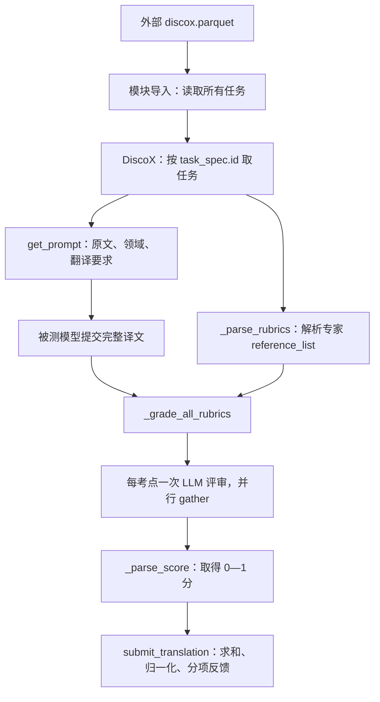
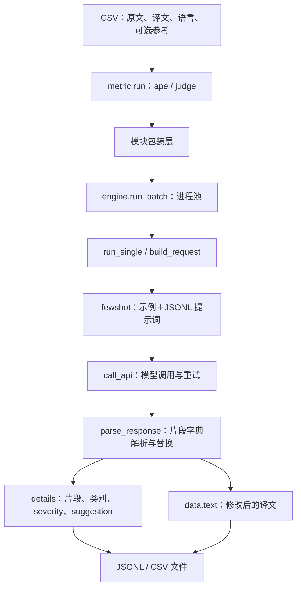
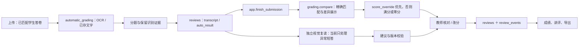
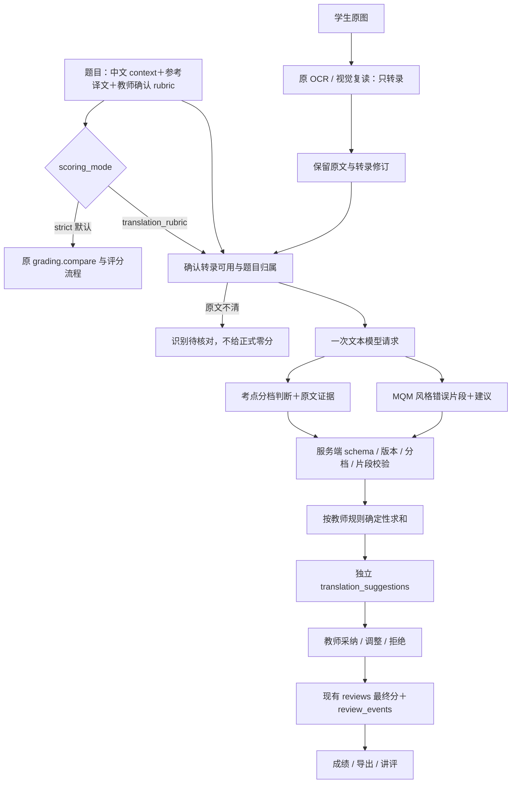

# TRANSLATION-RESEARCH-01：中译英 AI 评分开源项目技术调研

研究日期：2026-11-23。交付类型：源码调研与设计建议，等待产品负责人审核。

**结论：借鉴 DiscoX 的“专家考点逐项判断”，借鉴 Rubric-MQM 的“错误片段＋类别＋严重程度＋局部建议”，在默写本内实现独立的翻译建议评分流程。不要整体引入两个项目，不要用文本相似度替代翻译评分，不要让修改后的译文覆盖学生原文。**

本轮仅新增本文档。没有修改默写本业务代码、配置或数据库，没有提交 Git、部署服务或调用收费模型，没有读取或发送学生照片。

## 1. 研究基线、方法与证据边界

### 1.1 实际读取版本

| 对象 | 固定提交 | 已读范围 |
| --- | --- | --- |
| EnvCommons/DiscoX | [4784e77536bf7596f63c5883993e5bc55d472509](https://github.com/EnvCommons/DiscoX/tree/4784e77536bf7596f63c5883993e5bc55d472509) | 全部 Python 源码、README、Dockerfile、requirements.txt；另读取原始公开数据集的结构及一条考点样例 |
| trotacodigos/Rubric-MQM | [b210d0afe3df6b3eda9f6c46604bc15f81abb13a](https://github.com/trotacodigos/Rubric-MQM/tree/b210d0afe3df6b3eda9f6c46604bc15f81abb13a) | CLI、engine、调用层、提示词与 few-shot、parser、judge/ape 包装层、工具、配置、依赖、许可证；抽查 v1/v2 输出 |
| kaiqixue/moxieben，GitHub 基线 | [8c3c46e74e024ba0eaced1d7b46b14785952dd1d](https://github.com/kaiqixue/moxieben/tree/8c3c46e74e024ba0eaced1d7b46b14785952dd1d) | grading.py、automatic_grading.py、settings.py、app.py、grading_jobs.py；补读 teacher_auth.py、teacher_workbench.py、class_analysis.py、production.py 与相关测试 |
| 默写本本地工作区 | HEAD 为 f9279867416d53df3c76decc3f8e9aa1e3188cae，另有既存未提交改动 | 核对当前评分、自动整批复读和教师保存流程；本次不覆盖这些改动 |

Git 克隆遇到访问失败后，公开项目改用 GitHub 源码归档；默写本通过已有 GitHub CLI 只读权限下载指定提交，不改变工作区分支、索引或远端。两个公开归档的代码分别与指定 SHA 归档逐文件一致。Rubric-MQM 的提示词在归档里起初是 **Git LFS 指针**，已下载实际内容，并与指针 SHA-256 一致，不能把指针当成提示词。

可复核的归档 SHA-256：

- DiscoX：1dc647fdd00970da97e3e56d3d02393e005bcb655cf4074a7cac09e8c3b874f0。
- Rubric-MQM：5115396feeb0fd8b84567b4d3812bbbd50539fdb502b2a88c209d80de1f6b0a2。
- 默写本 GitHub 基线：c9bc6ba0240daff5b3600c8811b072ea071b624d414711dfdc34573410b2e1c3。

### 1.2 事实、推断和未验证事项

- **已验证事实**：下文文件、函数、数据字段、分数算法、许可证声明、13 项离线行为探针及 5 项严格评分探针。探针仅在临时目录提取纯函数或模拟边界，不安装外部项目，不执行其服务，不发模型请求。
- **合理推断**：逐考点判断加片段证据比“只给总分”更适合教师核对；是否实际减轻工作量，要由教师基准样本验证。
- **待验证**：对本校年级和题型的判分质量、同义译法公平性、OCR 错误影响、模型稳定性、真实时延与成本。没有真实评分实验，不引用 README 的效果数字作为默写本准确率。

### 1.3 GitHub 与本地差异必须区分

两处的 grading.py、automatic_grading.py 与 teacher_workbench.py 内容一致。GitHub 基线的 settings.py 仍有默认 limit=8，grading_jobs.py 仍按剩余额度调用旧自动复核函数；本地已经取消该限制，并使用整页后台复核、细分错误诊断和建议复用。它们都还没有本报告提出的翻译语义评分器。

本文默写本行号均指 **GitHub 固定提交**，不能直接套用到已有偏移的本地文件。后续实施应先整理本地与远端差异，不能为了对齐远端而覆盖现有功能。

## 2. DiscoX：专家考点如何转化为得分

### 2.1 实际架构



入口 server.py 使用 OpenReward Server 注册环境；它是**翻译模型评测环境**，不是带账号、教师确认和成绩库的教学应用。实际链路见 [discox.py](https://github.com/EnvCommons/DiscoX/blob/4784e77536bf7596f63c5883993e5bc55d472509/discox.py#L12-L40)、[server.py](https://github.com/EnvCommons/DiscoX/blob/4784e77536bf7596f63c5883993e5bc55d472509/server.py)。

### 2.2 翻译任务的数据结构

| 字段 | 用途 | 对默写本的启示 |
| --- | --- | --- |
| ori_text | 待翻译原文 | 每道翻译题必须明确保存中文原句，不能只存英文标准答案 |
| prompt | 翻译要求 | 明确是否指定结构、词汇、时态、语域 |
| reference_list | 专家制定的评分考点文本 | 应变成教师可审核、有版本的评分细则 |
| Primary_Domain / Secondary_Domain | 领域与子领域 | 可换成年级、题型或教学要求，首版不必建复杂领域体系 |
| prompt_id | 原数据标识 | 业务中使用现有 question_id 与 rubric_version |
| 运行时 id / direction | 顺序编号与翻译方向 | 中译英业务直接声明 zh→en，不照搬字符比例推断 |

源码在导入时找本地或 /orwd_data/discox.parquet，找不到即失败；然后用非空白字符中的汉字占比是否大于 30% 推断方向。公开 [原始数据集说明](https://huggingface.co/datasets/ByteDance-Seed/DiscoX/blob/main/README.md) 与本次读取的 discox.json 均有 200 条，reference_list 实测为字符串。**GitHub 仓库本身不含该数据文件，Dockerfile 也没有下载步骤，不能认定 clone 后就能独立运行。**

### 2.3 专家细则、得分点拆分和逐项评分

1. [DiscoX._parse_rubrics，128—171 行](https://github.com/EnvCommons/DiscoX/blob/4784e77536bf7596f63c5883993e5bc55d472509/discox.py#L128-L171)：优先按“考点N：”切分，次选阿拉伯数字列表，再把全文作为一个考点；空值退回整体质量。
2. 所有考点 points 固定 1.0。**没有按学校试卷要求分配不同权重，也没有自动从中文原句发现考点。**“专家先写考点”与“模型自动拆分评分标准”是两件事。
3. [_grade_single_rubric，222—259 行](https://github.com/EnvCommons/DiscoX/blob/4784e77536bf7596f63c5883993e5bc55d472509/discox.py#L222-L259)：给评审模型原文、学生/被测译文、领域和当前一个考点，要求分析加 0—1 得分；模型名称硬编码。
4. [_grade_all_rubrics / submit_translation，261—295 行](https://github.com/EnvCommons/DiscoX/blob/4784e77536bf7596f63c5883993e5bc55d472509/discox.py#L261-L295)：每个考点一次请求，asyncio.gather 并发，之后求和。

计算为：reward = Σ score_i / Σ max_points_i。由于当前每项满分为 1，实际上是考点得分的平均值。例如 4 项分别 1、0.5、1、0，则 reward=0.625；这不是学校 4 分题默认应该使用的评分规则。

### 2.4 不同合理译法怎样处理

它不是把译文和唯一标准答案逐字比较，而是让模型根据原文与考点评价。这使不同句式有机会得到相同认可；公开考点样例也能写“推荐表达”“不可误译”和多个可接受术语。

但代码没有同义表达图谱、等价性硬校验或教师申诉规则。是否认可某个替代表达，仍取决于考点内容与模型判断。默写本应明确“参考译文是示例”“除明确指定考查结构外，不因措辞不同扣分”，并用教师标注样本验证。

### 2.5 不能照搬的实现

| 源码设计 | 本次发现 | 默写本应怎样做 |
| --- | --- | --- |
| _parse_score 用正则和最后一个数字兜底 | 离线输入“No score; note 8”得到 0.8；没有分数得到 0 | 严格 JSON，缺项、非法数、超范围均标记失败，不能伪造成分数 |
| _grade_single_rubric 捕获异常后返回 0 | 服务错误可能成为学生某考点零分 | 评分失败与零分分开；保留待评分，不污染成绩 |
| 每考点并发请求 | 考点之间没有共享扣分约束，成本随题数×考点数增加 | 首版每个学生每道翻译一次请求，返回全部考点，再由服务器合计 |
| points 全为 1 | 没有教学权重与分档 | 教师设置每项满分和允许分档，总和校验 |
| 分析文本解析 | 解释里没有可校验的字符区间 | 输出学生原文证据片段、起止位置与考点 ID |
| 学术/专业翻译评测环境 | 不负责手写识别、租户、人工改分、持久化 | 只借鉴评审方法，沿用默写本业务闭环 |

另外 test_agent.py 的示例循环主要处理 function_call，而环境说明把普通回答交给隐藏终止工具；未运行框架会话，不能把这个示例当端到端通过证明。此项为静态一致性风险，不推断为已证实的框架缺陷。

## 3. Rubric-MQM：错误诊断和结构化反馈

### 3.1 当前版本实际架构



**这是读取源码得到的意图链路，不代表默认 CLI 可顺利跑通。** 下文列出已复现的断点。核心见 [engine.py](https://github.com/trotacodigos/Rubric-MQM/blob/b210d0afe3df6b3eda9f6c46604bc15f81abb13a/metric/core/engine.py)、[parser/parse.py](https://github.com/trotacodigos/Rubric-MQM/blob/b210d0afe3df6b3eda9f6c46604bc15f81abb13a/metric/parser/parse.py)。

### 3.2 错误识别、片段定位与分类

输入必需 src_lang、tgt_lang、src_text、target，可选 ref_text、domain。它处理的是**已转录文本**，不做 OCR 和照片定位。

[fewshot.gen_message / create_template](https://github.com/trotacodigos/Rubric-MQM/blob/b210d0afe3df6b3eda9f6c46604bc15f81abb13a/metric/prompt/fewshot.py#L6-L116) 把语言、原文、学生译文和可选参考放入消息，附 few-shot 样例。当前 [template.jsonl 实际 LFS 内容](https://media.githubusercontent.com/media/trotacodigos/Rubric-MQM/b210d0afe3df6b3eda9f6c46604bc15f81abb13a/metric/prompt/template.jsonl) 要求模型指出短词或短语，输出“以错误片段为键”的对象。它不是独立运行词法对齐算法后再找错。

模板列出 10 类：addition、mistranslation、omission、untranslated text、grammar、inconsistency、punctuation、word order、terminology、style。**解析器没有验证这些枚举，也没有确认片段确实存在于原译文。**

### 3.3 严重程度与分数：必须区分 v1 和 v2

- 当前 v2 模板要求 severity 为 **1—4**，从轻微到严重意义失真；详细的逐档教学评分映射没有实现。
- 历史 [data/v1/prompts/DR100.txt](https://github.com/trotacodigos/Rubric-MQM/blob/b210d0afe3df6b3eda9f6c46604bc15f81abb13a/data/v1/prompts/DR100.txt) 使用 1—100，给出十档影响说明，包含 no-error。历史结果与 README 负分示例不能直接当成 v2 当前算法。
- 当前 parse_response 只是保存模型给的 severity，没有数值类型/范围校验，也没有“错误严重度 → 学校试题分数”的汇总函数。judge.evaluate 也不是一个完成该换算的评分器。

**MQM 在这里是错误分类与影响程度的框架，不是现成的“中译英 4 分题自动给分公式”。** 对学校考点，否定意义丢失、时态错误和可接受同义表达的处理应由教师细则决定，不能直接减 severity 总和。

### 3.4 修改建议与结构化结果

[parse_response，23—85 行](https://github.com/trotacodigos/Rubric-MQM/blob/b210d0afe3df6b3eda9f6c46604bc15f81abb13a/metric/parser/parse.py#L23-L85) 尝试：

1. 解析模型片段对象；
2. 清理 suggestion；
3. 在目标文本中替换第一个出现的片段；
4. 保存 span、suggestion、category、severity；
5. 返回 success、data.text、data.tokens、details、error。

没有 start/end、重复片段序号、原文锚点或重叠解决策略。同一词两次出错无法用相同 JSON 键分别表示；替换顺序也可能改变后续片段。遗漏内容不在学生译文中，更需要原文片段和插入锚点。

默写本可以复用这种**反馈字段思想**，但必须保留 student_text，只把修改写进 correction_preview，不能改写作为评分依据的学生答案。

### 3.5 与教学评分冲突或不能照搬的地方

| 位置 | 代码事实与验证 | 后果与取舍 |
| --- | --- | --- |
| v2 template.jsonl 两条模板 | 都要求“You must find at least one issue” | 强迫找错，可能伤害满分答案；必须允许 errors=[]，润色偏好不得自动扣分 |
| parse.py:43—48 | 空 suggestion 和长度小于 2 的 span 被跳过 | “删掉多余词”和 a→an 等错误会漏掉；离线已复现 |
| parse.py:75—84 | 异常后仍 success=True、error=None | 非法 JSON 看起来像无错误；离线已复现，不能用于可靠成绩流程 |
| parse.py:60—73 | category、severity 原样接收；片段不必实际出现 | invented 类别、999 严重度也进入 details；离线已复现 |
| parse.py / utils.py | 字符串首处替换；段落恢复用 zip | 重复词可能改错位置；新增换行可能丢内容，离线已复现 |
| engine.py:76、102 | 将局部函数 _process_row 交 multiprocessing.Pool | 离线出现“Can't pickle local object”；默认批处理不能视为可用 |
| engine.py / modules/judge.py / modules/ape.py | run_batch 只写文件、无返回；包装层下标访问其返回值 | 包装层出现 NoneType 错误，离线模拟已复现 |
| fewshot.py:102—104 | 非空 domain 对包含 JSON 花括号的模板调用 format | domain='education' 时 KeyError，离线已复现 |
| engine.build_request / call_api.call_api | temperature、max_tokens 放外层，实际只发送内层 request | 配置参数及语义重试对它们的调整没有传到请求，离线结构探针确认 |
| call_api.py:45—108 | 一层最多 6 次重试，外层再试最多 3 轮 | 单次逻辑可能多次计费；对非幂等付费接口不能照搬，不是请求失败就必然没计费 |
| call_api.py:115—128 | get_api 的参数调用与 call_with_semantic_retry 签名不一致 | 批量辅助接口有静态缺陷，不在当前 CLI 主路径，未做线上调用验证 |
| requirements.txt | 列 openai、tenacity、pyyaml，未声明源码用到的 pandas、tqdm | 全新环境依赖不闭合，不应整体作为运行库引入 |

few-shot 示例中的空字符串删除建议与 parser 的过滤行为直接冲突。当前示例与模板更偏机器翻译后编辑，教师评分应减少为中文原句、考点和短译文的专用案例，不将多语种长例一律发送。

## 4. 许可证检查

| 项目 | 实际证据 | 本轮处理与后续边界 |
| --- | --- | --- |
| DiscoX 环境仓库 | README 的 License 段声明 CC-BY-4.0；所读归档没有独立 LICENSE，GitHub 元数据 license=null | 记录声明及检测差异，不把 null 理解为已证明无许可；本轮不复制代码，商用借用前应确认代码适用范围与署名方式 |
| DiscoX 原始数据 | Hugging Face 数据卡明确 license: cc-by-4.0 | 数据与环境代码分别核对；如后续用其考点/数据，要记录来源和修改，不能因可下载就省略署名 |
| Rubric-MQM | [LICENSE](https://github.com/trotacodigos/Rubric-MQM/blob/b210d0afe3df6b3eda9f6c46604bc15f81abb13a/LICENSE) 为 MIT，Copyright 2025 Ahrii | 可研究其设计；如后续复用实质代码或提示词，需处理原版权和许可通知。当前不复制 |

该表是本次许可文件核验与工程处置建议，不把数据许可证自动扩张成所有第三方素材的许可证。没有将两个仓库代码粘贴进默写本。

## 5. 默写本当前实现与可复用部分

### 5.1 当前评分链路



### 5.2 关键代码定位

| 文件 / 函数 / 路由 | 当前实际责任 | 复用或改造 |
| --- | --- | --- |
| [grading.py:6—20，normalize / compare](https://github.com/kaiqixue/moxieben/blob/8c3c46e74e024ba0eaced1d7b46b14785952dd1d/grading.py#L6-L20) | 只合并空白；answer/variants 精确匹配，SequenceMatcher 仅展示差异 | 完整保留给原题型；不能改成语义近似匹配 |
| [automatic_grading.py:49—92，candidates / persist_candidates](https://github.com/kaiqixue/moxieben/blob/8c3c46e74e024ba0eaced1d7b46b14785952dd1d/automatic_grading.py#L49-L92) | 提取机器证据，保护教师文字与已改分，记历史 | 复用 OCR/分题与保护；不要在这里直接拼入翻译扣分提示词 |
| automatic_grading.py:121—248，ocr_page / region_ocr / stored_region_candidates | 原图、整页与局部 OCR 留痕 | 可复用；翻译长句的跨行、跨块提取需补专门样本 |
| [automatic_grading.py:249—366，auto_grade](https://github.com/kaiqixue/moxieben/blob/8c3c46e74e024ba0eaced1d7b46b14785952dd1d/automatic_grading.py#L249-L366) | OCR、分题、失败处理，最终写 grading_state='final' | 要识别翻译 pending，不能把 OCR 完成当翻译成绩完成 |
| [app.py:529—562，finish_submission](https://github.com/kaiqixue/moxieben/blob/8c3c46e74e024ba0eaced1d7b46b14785952dd1d/app.py#L529-L562) | 总分唯一计算口；score_override 优先，否则严格零/满分 | 保留原分支；翻译建议分单列，不直接参加正式总分 |
| app.py:682—718，POST /api/tasks | kind 仅 word/phrase/sentence/grammar；有 context、answer、variants、points | 首版沿用 sentence，新增显式 scoring_mode 和 rubric，不误伤旧句子默写 |
| [settings.py:105—142，_chat](https://github.com/kaiqixue/moxieben/blob/8c3c46e74e024ba0eaced1d7b46b14785952dd1d/settings.py#L105-L142) | OpenAI 兼容图片请求、超时、响应大小、禁止重定向、错误处理 | 复用受控 HTTP 边界；现函数固定附图片，不能直接当纯文本评分 API |
| settings.py:185—247，reread_page / reread_handwriting | 忠实转录、不传参考答案；文本最多 160 字符、20 词等 | 不能复用其输出 schema 评分翻译，也不能取消旧限制影响短答 |
| [app.py:1338—1425，save_review](https://github.com/kaiqixue/moxieben/blob/8c3c46e74e024ba0eaced1d7b46b14785952dd1d/app.py#L1338-L1425) | 教师判定、分数上下限、改分原因、事务、历史快照 | 复用最终写入路径，新增服务端校验的翻译建议采纳分支 |
| app.py:1427—1457，undo_quick_review | 仅允许既定 action、版本及最新记录撤销 | 要显式加入翻译采纳 action；当前普通手动 score_override 记录不能宣称已支持该快捷撤销 |
| app.py:891—898，review_page_revision / visual_revision | 防旧建议覆盖新答卷；签名含全答卷历史 | 可借鉴但不原封复用：翻译建议宜按题及评分细则修订校验，避免同答卷改一题使所有兄弟题失效 |
| grading_jobs.py:160—204、251—304 | 任务持久化、教师身份恢复、重启继续、阶段游标 | 扩展一个翻译阶段，不新增任务框架；每道评分需独立保留状态 |
| app.py:346—377、471—483；teacher_auth.py:145—181 | 路由白名单、归属检查、登录、CSRF | 新 API 必须加入白名单并先通过所属答卷核验，不能只靠 qid |
| production.py:28—68 | 平台密钥文件、OCR/视觉配置、受控出站地址 | 翻译服务按同一原则配置；教师看不到平台 Key |
| class_analysis.py:37—54；teacher_workbench.py:10—32 | 正式成绩、待核对、讲评统计共享状态口径 | pending 翻译不能进入普通错题统计；建议分不可冒充最终分 |

### 5.3 已证实的能力边界

5 项隔离严格比较探针：空白合并可通过；大小写、标点不同不通过；显式变体可通过；两句合理同义表达不会自动判等。其结果符合现有默写设计，并不是把 compare 写错了。

现有数据库和接口支持教师给部分分：score_override 可为 0 到本题满分内、最多两位小数的有限数，且需 reason。**这可以作为翻译教师最终分的落点，但不是现成的 AI 建议分存储。** 直接把模型分数写这里会使 finish_submission 立即当正式成绩，破坏建议/确认分离。

现有 visual_suggestions 是图片复读记录，有必填 page_id、crop、转录 schema 和专用采纳规则；不宜强塞翻译评语。可复用设计和底层历史表，不复用错误的数据语义。

## 6. 最终推荐：双层评价，单一计分来源

### 6.1 面向教师的工作流

1. 建立翻译题：中文原句、参考译文、允许变体、每题满分、是否指定结构。
2. 教师确认评分细则。以后可让 AI 草拟，但首版不做自动出细则即自动评分。
3. 上传后复用现有身份匹配、OCR、分题；识别不清先解决原文证据，不把 OCR 的错认当语法错。
4. 稳定转录进入后台翻译建议评分，无需教师逐题发起；不把识别正常翻译漏掉，因为“文字看清”不等于“翻译正确”。
5. 老师看到中文、学生原文、建议总分、各考点依据、错误片段和改法。可采纳、改分、拒绝建议，集中核对高风险项。
6. 首版采纳后才记入正式成绩；未采纳显示“建议 2.5/4，待确认”，不是“0/4”。后续是否开放自动确认应另立质量门槛，不由本轮调研默认授权。

### 6.2 推荐架构图



**双层**指：考点决定建议分，错误诊断解释原因。两者可以在同一次模型响应中返回，不等于必须调用两个模型。模型判断“哪个分档和为什么”，服务器负责合法性、合计、步长和最终权限。

### 6.3 如何拆分得分点：教学示例

以下是本报告自拟示例，不是从开源项目复制的评分标准，也不是全国统一中学考试标准。

中文：尽管下着大雨，他还是按时到校了。参考：Although it was raining heavily, he arrived at school on time.

| 考点 ID | 满分 | 示例分档 | 要求 |
| --- | --- | --- | --- |
| C1 | 1 | 0 / 0.5 / 1 | 正确表达让步关系，可接受 Although / Despite 等合理结构，除非教师明确指定 |
| C2 | 1 | 0 / 0.5 / 1 | 保留大雨与程度含义 |
| C3 | 1 | 0 / 0.5 / 1 | 正确表达主体、过去的到校事件 |
| C4 | 1 | 0 / 0.5 / 1 | 正确表达按时，并满足教师明确的必要语法要求 |

推荐规则：建议分 = Σ criterion_award_i，且每项 award 必须属于该项 allowed_scores，满分总和等于题目 points。只有预先定义的依赖、封顶、互斥规则才可影响求和，首版不做通用规则语言。

例如 Despite the heavy rain, he got to school on time. 不应仅因不等于参考句扣分。如果题干明确“用 although”，则 C1 的结构要求才适用。错误记录引用 criterion_ids 与扣分理由，**不另把 severity 换成第二笔扣分**，避免同一个时态错既扣考点又扣 MQM 分。

### 6.4 输出契约（建议，尚未实现）

服务端以不可变学生文本、rubric_version、模型和提示词版本生成输入签名。模型只返回固定 rubric ID 的判断与 errors 数组；示例结构：

```json
{
  "status": "reviewable",
  "criteria": [
    {"id": "C1", "award": 1, "evidence": [{"start": 0, "end": 7, "text": "Despite"}], "reason": "让步关系成立"}
  ],
  "errors": [],
  "needs_teacher": true
}
```

上面只展示字段形状，不是完整 4 考点合法响应。真实响应必须一次覆盖全部考点且无重复；服务器计算 suggested_score，模型自报总分即使存在也不作为权威。error 项建议包括：id、category、severity、criterion_ids、target_span、source_span、operation、suggestion、reason。

必须具备以下校验：

- 允许 errors=[]；不因表达可润色就扣分。severity 首版可用 minor/major/critical 的封闭枚举，定义由教学样本校准，与上游 1—4 或 1—100 不做假定等价。
- target_span 使用 start/end/text；原文切片必须完全一致。中文 source_span 针对遗漏和意义来源，不把缺失词伪装为已出现片段。
- omission 可用目标 start=end 的插入锚点，需合法来源证据；删除 suggestion 允许空字符串；单字符合法；同词多次可用不同区间，不能以词为 JSON 唯一键。
- 片段使用原始文本的 Unicode 码点半开区间 [start,end)，不要在 normalize 后定位。浏览器 UTF-16 偏移需显式转换或按码点数组渲染，尤其是弯引号、表情和非 BMP 字符。
- 文本、数组、理由长度设边界；分数拒绝 bool、NaN、Infinity、字符串、超分、缺项；权重和步长校验在服务端。
- 错误相互重叠或同一现象重复归类时合并解释，不重复扣分；纠正预览应按原文区间处理，永远不覆盖 student_text。
- 模型文本和学生输入作为数据处理，隔离提示注入；输出到 HTML 时转义。失败、超时、截断是评分失败，不能转成无错或零分。
- 同一输入签名复用建议；真实模型结果不靠自报置信度判断准确率，不直接记录密钥或原始请求到普通日志。

## 7. 数据与 API 的最小改造建议

### 7.1 题目与建议存储

**建议后续新增，当前未迁移：**

1. questions.scoring_mode，默认 strict；首版翻译使用 kind=sentence 且 mode=translation_rubric，旧句子默写仍是 strict。
2. questions.translation_rubric JSON：版本、教师确认状态、考点、满分、允许分档与必要约束。中文原句复用 context，模式启用时明确该字段语义和必填；answer/variants 继续做参考译文，不再作为唯一字符串判等标准。
3. 独立 translation_suggestions 表：id、submission_id、question_id、revision、created_at、status、result JSON。result 包含分项判断、证据、诊断、服务端建议分、模型/提示词/schema/rubric 版本、耗时、usage 和固定错误类别。
4. 教师采纳仍写 reviews.score_override、confirmed、reason，并写 review_events 的 before/after 与 translation_suggestion_id。教师自行改分不覆盖旧 AI 记录；拒绝建议可作为独立审计事件。

所有权通过所属 submissions / tasks 核验，新增关联须保证 question 与 submission 属于同一 task；查询建议先验证所属教师，不能直接凭建议 ID 读数据。历史删除流程要纳入新表与外键，否则会留下孤儿记录。暂不需要向量数据库、Redis、Celery、检索库或模型微调。

为什么建议一张新表：现有 visual_suggestions 与图片绑定，auto_result 则会被 OCR 重算更新；独立建议需要多次留痕和明确状态。只加 JSON 到 reviews 虽更少字段，却容易让旧判分链误认为最终结果，节省不了后续维护成本。

### 7.2 建议 API 契约

| 方法与地址 | 作用 | 主要约束 |
| --- | --- | --- |
| PATCH /api/tasks/{tid}/questions/{qid}/translation-rubric | 教师保存/确认评分细则 | 校验所属任务、归档状态、总权重、分档；编辑后旧建议失效但不覆盖教师旧分 |
| POST /api/submissions/{sid}/reviews/{qid}/translation-suggestions | 持久化发起单题建议任务 | 请求只带输入版本；服务器读取原文、rubric 和学生转录，不接受前端指定他人文本/密钥 |
| GET /api/submissions/{sid}/reviews/{qid}/translation-suggestions | 获取最新有效结果及状态 | 查自己的答卷；stale 明确显示，不伪装成当前建议 |
| POST /api/submissions/{sid}/reviews/{qid} | 沿用现有教师保存入口 | 新增 translation_suggestion_id 分支，服务端取分；不能与 visual_suggestion_id / quick_decision 混用 |
| POST /api/submissions/{sid}/reviews/{qid}/undo | 沿用撤销入口 | 扩展翻译采纳 action 和快照检查；不得只靠前端恢复旧分 |

发起接口首次返回 202 与已有任务资源，幂等命中已有建议时返回 200；无需新增一套异步框架。租户越权统一 404，未登录沿用认证规则，版本过期/归档/活动任务冲突返回 409；模型失败在任务/建议中保存固定错误类别。具体命名需实施前与现有路由规范对齐，上述接口现在不存在。

普通手动调整可继续使用现有 score_override＋reason，但“采纳 AI 建议”必须让服务端确认建议 ID、版本、分数及题目归属，不能由浏览器提交任意声称来自 AI 的数值。

### 7.3 状态与成绩：最容易遗漏的部分

推荐单题翻译状态：not_requested → queued → running → suggested / failed → teacher_confirmed。文本或细则变化后建议为 stale。这些状态不能与“看不清的 OCR 异常”混用。

- 默认 strict 仍走现有 finish_submission 分支，原 word/phrase/grammar 行为不变。
- 翻译未确认：final_score=null、suggested_score 单列、needs_review=true；不能利用现有“未匹配就 0 分”的兜底。
- 整份混合答卷还有未确认翻译时，正式总分为待定。可显示“已确认小计/整卷满分”和单独建议总分，不能把小计标成正式零分或最终成绩。
- 只完成 OCR 时，翻译 pending，不能仍被 automatic_grading 的 grading_state='final' 当成全卷结束。
- 班级列表、讲评、成绩导出、均分和错题统计都使用共享状态口径。现有汇总与模板可能假定 score 总为数值，必须一起回归，不能只给详情页加一个 AI 面板。
- 首版建议等待确认的翻译全部出现在教师工作区；不要局限于旧 uncertain OCR 队列，否则清晰识别但翻译错误的题永远不会评分。

### 7.4 后台与模型配置

复用 grading_jobs 的 SQLite 任务、教师上下文和单工作线程。在 OCR/分题完成后按 scoring_mode 分流，translation 阶段按题记录已预约、已完成、失败和输入签名；续跑不重复调用已成功任务。旧 ai_review 阶段仅管短答复读，不复用其“只有识别异常才处理”的条件。

翻译评分优先发**文本**：中文原句、教师规则、参考示例和学生原文。看图只用于恢复转录；复读时不传标准答案，评分时才传细则，避免模型边看图边把学生错误脑补正确。

受控 HTTP 请求、出站域名、密钥文件与脱敏日志复用现有机制；新增用途明确的翻译文本请求函数与配置，可引用同一平台服务凭据，不强制注册第二家服务商，不复制一份 Key 到业务表。现有 _chat 固定带图，不能传虚构空白图冒充文本接口。无需为此引入完整代理框架或 OpenReward。

## 8. 值得借鉴与不采用内容总表

| 设计 | 决策 | 理由 |
| --- | --- | --- |
| 专家考点逐项评审 | 采用并改成教师权重/分档 | 便于解释部分分，允许多种正确译法 |
| 原文、要求、领域/语境明确分开 | 采用最小字段 | 评价知道考什么，避免只看参考句 |
| MQM 片段错误与局部建议 | 采用概念，独立实现严格 schema | 便于讲评、定位和纠错，不改学生原文 |
| 参考译文可选、无错结果 | 参考可多例；必须允许无错 | 避免只接受一条参考表达和强迫挑错 |
| 每考点一次无限并发 | 不采用 | 成本高、上下文重复、重复扣分难控制 |
| 开源 parser 的宽松容错 | 不采用 | 出错变成功或零分，不能用于成绩 |
| APE 自动改写作为评分对象 | 不采用 | 改好后的译文不代表学生原答 |
| OpenReward 环境 / CSV 进程池整套导入 | 不采用 | 与 Flask 教师业务不匹配且现有实现有断点 |
| 自动研究型负分直接变试卷分 | 不采用 | 缺少教学标尺与校准依据 |
| 一上来开发作文评分、多代理、训练模型 | 暂不采用 | 先把单句中译英的建议/确认闭环验证清楚 |

## 9. 下一步最小开发任务

**第一项真正应编码：TRANS-01，纯文本翻译建议评分的离线契约与确定性计分器。** 使用一题、教师确认的 3—4 个考点、虚构学生答案、模拟模型 JSON；验证标准、同义表达、错误片段与总分计算，不接真实 OCR、不写正式分数。此任务通过后才接数据库和后台。

| 编号 | 优先级 | 最小交付 | 验收与前置 |
| --- | --- | --- | --- |
| TRANS-00 | P0 | 确认一个实际年级题型及教师评分样本；核对本地与远端基线 | 产品审核本报告；不把研究指标当教学规则 |
| TRANS-01 | P0 | translation_grading.py：输入/输出校验、分档检查、片段校验、确定性求和；独立测试 | 同义译法不因参考不同被机器规则拒绝；非法响应必须失败；不依赖业务数据库 |
| TRANS-02 | P0 | 评分模式、rubric、独立建议持久化与修订签名；纯文本模型边界 | 仅隔离测试库迁移；教师 A/B 越权、原文保留、费用/失败日志脱敏 |
| TRANS-03 | P0 | 建议 API＋现有任务 translation 阶段＋教师采纳/改分/撤销 | 超时不中断旧成绩；重启无重复收费；过期建议不能采纳；不开放自动终审 |
| TRANS-04 | P0 | pending 成绩语义与核对界面、导出/讲评一致 | 未评分不显示零分，单词/短语/语法/旧句子默写无行为变化 |
| TRANS-05 | P1 | 真实教师基准与经授权样本的小试 | 达到预先约定的质量与工作量指标，再决定扩大范围 |
| TRANS-06 | P2 | AI 草拟评分细则、批量采纳或特定低风险自动确认 | 另立计划与审批；首版不默认包含 |

以上是依赖顺序，不是未经评估的人日承诺。首版最大难点是**制定可复现的教学评分细则、区分 OCR 错误与学生错误、以及正式成绩的 pending/确认状态一致性**，不是“能不能再加一个模型 URL”。

## 10. 验证记录与建议验收标准

### 10.1 本轮已执行的离线探针

| # | 检查 | 观察结果 |
| --- | --- | --- |
| 1 | DiscoX 解析两个“考点” | 得到两个 1.0 分项 |
| 2 | DiscoX 缺 Score 的文本末尾有 8 | 返回 0.8，显示宽松解析误取数 |
| 3 | DiscoX 完全无分数字段 | 返回 0.0，错误与零分混同 |
| 4 | MQM 非 JSON 返回 | success=true、details=[] |
| 5 | MQM 删除建议为空字符串 | 被跳过，原文不变 |
| 6 | MQM 单字符 a→an | 被跳过，原文不变 |
| 7 | MQM 不存在的 span＋invented 类别＋999 严重度 | 仍进入 details |
| 8 | MQM 段落恢复：单段变两行 | 后一行丢失 |
| 9 | MQM 非空 domain 填充模板 | JSON 花括号触发 KeyError |
| 10 | MQM 组装请求参数 | 实际内层仅 model/messages，解码参数在外层 |
| 11 | MQM 进程池任务 | 局部 worker 无法 pickle |
| 12 | MQM judge 包装层读取 run_batch 返回 | NoneType 下标错误 |
| 13 | MQM ape 包装层读取 run_batch 返回 | NoneType 下标错误 |

另外执行 5 项默写本 GitHub 基线纯函数检查：空白合并、大小写、标点、显式变体、同义整句，均符合当前严格规则。未运行第三方完整应用、未声称其线上服务不可用；上述结论限定为所读提交的对应函数及默认链路。

### 10.2 后续产品验收，不能省略

- 合成回归：满分多译、局部正确、否定丢失、时态、单复数、拼写、缺译、多译、空白、OCR 读不清；无错答案不得强迫找错。
- 输出安全：缺/重复考点、非有限数、超范围、伪造 span、重复词不同位置、遗漏锚点、重叠错误、弯引号与 Unicode、提示注入、脚本转义。
- 状态安全：AI 建议不改正式分；教师调整和撤销有历史；转录/细则变动使旧建议失效；其他教师不可读写；归档只读；批量兄弟题不相互失效。
- 业务回归：原 word/phrase/grammar 和 strict sentence 结果逐项与改造前一致；首页、核对、讲评、CSV/XLSX、离线报告不把 pending 当错题或零分。
- 稳定性：接口超时、限流、格式错误、任务中断、成功结果重复请求；一次付费请求状态未知时不自动无上限重发。
- 教师基准：建议先准备至少 50—100 条经授权且去标识化的短句样本作为试点起点，由两位教师独立评分并裁决分歧，覆盖不同合理译法；这些是建议采样量，不是已验证充分的统计样本量。
- 统计与阈值：记录模型可用返回率、与裁决分差、精确分档一致率、过度扣分率、错误定位有效率、教师采纳/修改率、每份核对时间、请求耗时及实际 usage。若记录 MAE=平均绝对分差，应在各题满分一致或归一化后比较。上线阈值由产品与教师预先约定，不虚构本轮准确率和成本。

## 11. 最终建议与本轮完成边界

1. DiscoX 回答“按哪些教学得分点评价”，但它的等权奖励和失败零分不适合直接进入试卷成绩。
2. Rubric-MQM 回答“哪里可能有错、哪一类、怎样局部改”，但当前 v2 强迫找错和解析/运行断点必须规避，不应作为现成评分服务接入。
3. 默写本已有身份、OCR、答卷、教师部分分、历史、后台和成绩闭环，可保留；新增的是翻译细则、独立建议评分与确认状态，不能重写或放宽旧严格比较。
4. 推荐从 **一题纯文本、教师确认 rubric、模型逐考点判断、服务端计分、教师确认入正式成绩** 开始，随后接自动后台和集中核对。

交付后停止，等待项目负责人审核。本轮不实施上述新增 API、表或评分行为。
