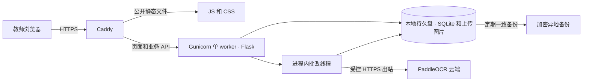

# 部署架构与环境划分

> 本轮目标覆盖 Ubuntu 22.04 LTS（宿主）与 Python 3.11 Debian 容器；旧方案 24.04 是原建议，不是本轮强制迁移要求。当前 Caddy 转发全部同源请求，无独立前端构建。执行文件和边界见 [服务器操作手册](SERVER-OPERATIONS.md)。

首期采用 Ubuntu Server 24.04 LTS、Docker Compose、Caddy、单个 Flask/Gunicorn 应用进程、SQLite 本地持久化及云端 Paddle OCR。HTTPS 入口与应用容器分离，浏览器始终使用同一域名。[Ubuntu LTS 版本](https://ubuntu.com/project/docs/release-team/list-of-releases/) · [Flask 生产部署](https://flask.palletsprojects.com/en/stable/deploying/)

| 环境 | 数据 | 配置与访问 | 发布方式 |
| --- | --- | --- | --- |
| Local | 每位开发者的本地样本和临时 SQLite | 仅本机。测试用模拟 OCR，凭据独立 | Windows 启动脚本，或按需使用隔离容器 |
| Staging | 仅合成名册、照片、答卷和成绩 | 单独主机或独立安全边界，专用域名、卷、账号、会话和 OCR 凭据。通过 VPN 或访问网关限制测试人员 | main 通过 CI 后自动部署 |
| Production | 正式数据及独立备份 | 专用主机、正式域名、教师独立账号、生产密钥和备份权限。SSH 只对管理入口开放 | 人工批准并按已验收的镜像摘要发布 |

- **前后端分工。** 静态文件可由 Caddy 从同一候选版本已打包的只读静态目录提供，应用路由、动态 HTML、API、照片和下载都由 Flask 提供。最小版本也允许 Caddy 转发全部路由，这能省去静态包同步，保留未来拆分空间。前端无需 npm 构建，保持同源凭据及 CSRF。
- **教师边界。** 首期优先单校试用，每名教师使用独立账号，只可访问自己拥有或明确分配的班级。任务、临时答卷、照片、学生档案、姓名纠错、报告及导出按所属范围授权。管理员跨班操作要有明确角色及审计记录。无归属的历史记录默认不可见，后续通过经授权的归属流程确认。
- **SQLite 与图片。** 首期以一个应用容器、一个进程及一块本地文件系统为标准。短事务，外联在事务外，监控写锁等待。数据库和原图均绑定持久目录，Flask 授权后再服务文件。持续发生写锁争用、有多实例或高可用硬要求时，再评估 PostgreSQL、共享对象存储和独立队列。
- **域名与 HTTPS。** 分配两个独立子域并指向各自入口 IP，配置 A 记录，IPv6 验证完成后再设 AAAA。Caddy 公网开放 80/443 以便签发和续期，持久化证书状态，限制直达后端。限定真实 Host 与可信代理层数，验收 Origin、登录 Cookie 和转发头。启用 HTTPS 后确认自动续期和证书过期告警。[Caddy 自动 HTTPS](https://caddyserver.com/docs/automatic-https) · [Flask 代理配置](https://flask.palletsprojects.com/en/stable/deploying/proxy_fix/)

产品审核默认项为单校小规模试点、Ubuntu 24.04 x86_64、云 OCR 优先、后端单进程及同源前端。上线数量以压测、任务耗时和供应商配额为准。
