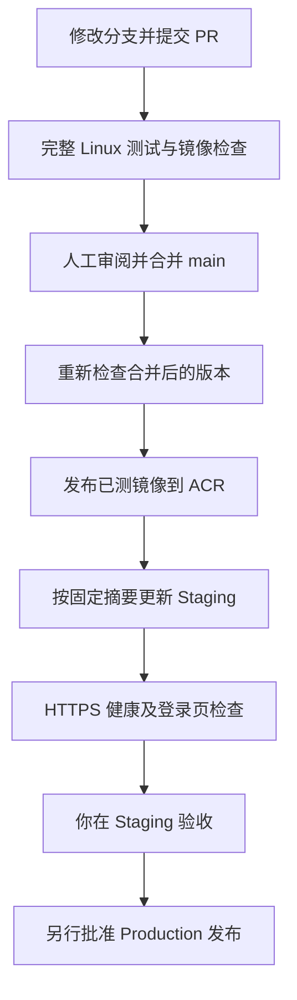

# GitHub → ACR → Staging 自动更新

## 当前交付与边界

本批候选版本包含自动化流程、教师本地 OCR/AI 配置隔离、后台 AI 复核与离线补定位，以及干净源码测试依赖。未修改数据库结构、Dockerfile、Compose 或服务器注册开关。Production 没有自动发布任务，也没有使用生产凭据。提交、CI 和 Staging 实际发布状态以 GitHub 记录及服务器核验为准；以下一次性准备项不是已经安装的证明。

当前运行镜像使用 cloud-only 依赖，不包含本地 Paddle 和模型缓存。离线补定位会在环境不具备时安全跳过；本地教师的 AI 设置不会复制到 Staging，线上仍由平台 VLM_REVIEW_* 配置控制。发布代码不得自动开启这些开关或复制本地密钥。

已核验：仓库为 `kaiqixue/moxieben`；当前分支 `feature/mp-02a-teacher-accounts`、HEAD `55edb3840a1c56698c6656e8b6778854aeec02d7`；审查时远端原本没有工作流。此前 RELEASE-02 的四项暂存内容继续保留。

服务器当前状态不作为本轮新证据：未连接 ECS。Compose 实际路径、机器资源、备份容量、ACR 地域/权限、服务器主机指纹、旧镜像 RepoDigest、GitHub 环境权限均待现场核验。此前给出的 ACR 域名属于杭州；ECS 目标为上海，须确认真实仓库端点，不凭地域猜地址。

## 已完成的实现计划

- [x] 先写受限命令、归属配置、备份顺序、恢复边界的失败测试，再实现脚本。
- [x] 复用 `backup_data.py`，固定 Staging 数据目录，按摘要更新 app。
- [x] 编写独立测试镜像、完整 unittest 入口、GitHub 工作流。
- [x] PR 不提供发布凭据；发布重用已测镜像；Production 独立人工批准。
- [x] 通过独立审查补强原容器恢复、磁盘失败关闭入口、镜像内部 Gunicorn 验证和中断记录。
- [ ] 首次 GitHub Linux/Docker 实际运行，以及 ECS 隔离演练、主机安装和首次更新。以上尚未执行。

## 以后如何更新



| 操作 | 行为 |
| --- | --- |
| PR 新建/更新 | 构建和测试；不登录 ACR，不连接 ECS。 |
| 主仓库 main 推送/合并 | 重新检查；配置齐全后发布镜像。 |
| 手动选择 main 运行 | 同样检查、发布，并在已启用时更新 Staging。 |
| 手动选择其他分支、fork 推送 | 不发布到本项目 ACR/ECS。 |
| 未配置 ACR | 检查照常，publish 跳过。 |
| `STAGING_AUTO_DEPLOY` 未设置或不等于 `true` | 不连接服务器。 |
| main 已产生更新提交 | 旧运行拒绝部署，避免较旧构建覆盖新版本。 |

分支保护应要求 `Linux tests and runtime image` 检查通过、负责人审阅，并禁止随意直接推 main。工作流本身不会禁止有权限者绕过 PR；这需要 GitHub Rulesets/分支保护。

## 文件与测试方式

- `.github/workflows/main.yml`：检查、发布、Staging 三个 job，Action 固定提交 SHA。
- `Dockerfile.ci`：继承运行镜像，只额外安装测试需要的 `pypdf==6.21.4`；运行镜像不包含这层测试依赖。
- `scripts/ci_verify.py`：默认发现全部 unittest，输出数量、失败、错误、跳过明细；Gunicorn 用例未执行或跳过均阻止发布。
- `test_server_runtime.py`：本地仍从源码目录启动；CI 指定 `/app`，从镜像内部启动 Gunicorn，检查健康、登录、静态资源、停止、重启及临时数据持久化。
- `scripts/deploy_staging.py`：安装后由服务器固定入口执行，参数只有摘要和完整 Git SHA。
- `test_deployment.py`：受限输入、配置保护、发布顺序、失败分支、真实合成备份验证与原子镜像配置测试。
- `.gitignore`：只增加上述两个脚本的精确例外；`.dockerignore`：只增加测试 Dockerfile。业务数据、密钥和测试资源仍不会进入运行镜像。

首次 PR 还必须包含此前 RELEASE-02 已暂存的 `scripts/migrate_single_teacher.py`、两个 OCR JSON 样本及对应 `.gitignore` 例外，否则干净 checkout 会重现缺少测试依赖的问题。不要只上传本轮工作流而遗漏这些已审查依赖。

CI 完整测试运行在非 root、只读文件系统、只读源码挂载的临时容器中；`--network none` 保留本机回环，允许 Gunicorn 子进程测试，禁止外部 OCR/VLM 网络访问。测试不挂载 Staging data/secrets，不使用真实凭据。备份/迁移用例仅操作合成临时数据库，绝不操作业务库。

测试发现和发布分开：全套单测使用 checkout，Gunicorn 生命周期使用镜像 `/app`。通过后保存运行镜像，由 publish 直接加载同一制品，不重新构建。镜像标签为 `sha-<完整 Git SHA>`，部署参数使用 `repository@sha256:...`，不依赖 latest。Docker 本地 Image ID 和仓库 RepoDigest 是两种不同标识，不能互换。

残留 Word 样本跳过不属于本轮删除/跳过：原测试要求未跟踪的 `tests/fixtures/grammar_sample.docx`。需要授权且脱敏、符合原断言的样本才能补齐。Windows 上 Gunicorn 仍按原条件跳过；GitHub Linux 门禁会强制实际执行。

## GitHub 一次性配置（尚未实施）

在仓库 Settings 配置以下 Variables，值由现场核验后填写：

| Variable | 示例或含义 |
| --- | --- |
| `ACR_REGISTRY` | 实际 ACR 登录域名，无 scheme、无仓库路径。 |
| `ACR_REPOSITORY` | 实际 `命名空间/镜像名`，例如 `bansui/bansui`。 |
| `STAGING_AUTO_DEPLOY` | 首次先留空；演练及人工批准后才设为 `true`。 |
| `STAGING_SSH_HOST` | `101.132.236.178`，配置前确认仍为目标 Staging。 |
| `STAGING_SSH_USER` | 新建专用受限用户，例如 `moxieben-deploy`，不使用 admin。 |
| `STAGING_SSH_PORT` | 实际 SSH 端口，默认 22。 |
| `STAGING_SSH_KNOWN_HOSTS` | 经管理员核对的完整 known_hosts 条目；非默认端口使用对应 `[host]:port` 格式。不能用未核验 ssh-keyscan 替代指纹核对。 |

创建 `image-publish` 与 `staging` 两个 GitHub Environments，部署分支仅允许 main：

| Environment Secret | 用途 |
| --- | --- |
| image-publish / `ACR_PUSH_USERNAME` | 专用镜像推送身份。 |
| image-publish / `ACR_PUSH_PASSWORD` | 对应 ACR 凭据，通过 password-stdin 登录。 |
| staging / `STAGING_DEPLOY_KEY` | 专用自动化 SSH 私钥，不复用个人 moxieben_windows 密钥。 |

ACR 推送权限和 ECS 拉取权限分开，尽可能限制到本仓库；实际个人版/实例版可提供的授权粒度待核验。业务 OCR Key、数据库、session_key 不放入 GitHub。服务器上的拉取凭据只由管理员配置。

私有仓库是否支持 Environment Secrets、所需审阅人和分支规则取决于订阅，必须现场确认。手动点 workflow_dispatch 不等于生产审批。本工作流不设置 Production job；若订阅不能提供可靠审批，Production 继续由独立运维身份在批准后手动发布相同摘要。

[GitHub 环境说明](https://docs.github.com/en/actions/reference/workflows-and-actions/deployments-and-environments) · [Actions 安全实践](https://docs.github.com/en/actions/reference/security/secure-use)

ACR 原生自动构建与 Actions 构建只能选一个发布入口，避免“跳过测试也能覆盖标签”。本实现由 Actions 构建并 push；ACR 无需再从 main 自动构建。ACR webhook 只是通知，需要接收方才能更新普通 ECS Compose，当前由 Actions 受限 SSH 完成更新。

[ACR 构建文档](https://help.aliyun.com/zh/acr/user-guide/create-a-repository-and-build-images) · [ACR webhook 文档](https://help.aliyun.com/zh/acr/user-guide/manage-webhooks)

## ECS 一次性准备（修改服务器，须另行确认）

先用只读检查确认 Compose 的实际 project directory、配置文件、env 文件、Caddyfile 挂载、data/secrets 挂载、主机架构、Docker Compose v2、Python 3、磁盘余量和备份目录权限。不得输出 `.env` 或完整容器环境。

当前脚本只接受：项目名 `moxieben-staging`、服务恰好 app/caddy、`APP_ENV=staging`、`REGISTRATION_OPEN=0`、`DATA_DIR=/var/lib/moxieben`、数据 bind `/srv/moxieben/staging/data` 且不自动新建。其他可写容器挂载与数据目录重叠时拒绝更新；宿主机上的其他写入程序仍需管理员确认不存在。

以下是安装命令模板，不是本轮已经执行的命令。必须从审阅过的源码包安装，替换所有占位路径；不要将 GitHub 传入路径作为 root 配置。

```bash
# 由 admin 在服务器上执行，来源目录为已审阅的上传源码包。
sudo install -o root -g root -m 0755 scripts/deploy_staging.py /usr/local/libexec/moxieben-staging-deploy.py
sudo install -o root -g root -m 0755 backup_data.py /usr/local/libexec/moxieben-backup.py
sudo install -d -o root -g root -m 0700 /srv/moxieben/staging/backups
```

`/usr/local/libexec` 及 `/srv/moxieben/staging` 等父目录也须 root 所有且不可由普通用户写入。不要递归改 data 或 secrets 的属主/权限，应用 UID 10001 仍需正常读写原数据。现有路径若不满足保护要求，应先审阅所有权调整方案，脚本会拒绝继续，不会代改权限。

由管理员创建 root:root、0600 的 `/etc/moxieben-staging-deploy.json`，结构如下（此文件只包含路径与镜像库名，不包含密钥内容）：

```json
{
  "repository": "REPLACE_WITH_VERIFIED_ACR_HOST/namespace/repository",
  "project_dir": "/REPLACE_WITH_VERIFIED_EXISTING_COMPOSE_DIRECTORY",
  "compose_file": "/REPLACE_WITH_VERIFIED_PROTECTED_COMPOSE_FILE",
  "env_file": "/REPLACE_WITH_VERIFIED_PROTECTED_ENV_FILE",
  "ca_file": "/etc/moxieben-staging-caddy-root.crt"
}
```

project_dir、compose_file、env_file、Caddy bind 源、secret 文件及所有父目录须 root 所有、不可 group/world 写入、无符号链接。注册开关继续为 0。保留原 project directory，避免相对 Caddyfile 路径变化。不要直接把仓库可由普通用户修改的文件交给 sudo 执行。

若 Caddy 使用 internal TLS，`ca_file` 只安装它的公开 CA 证书（不是私钥），经核对后 root 所有；若使用系统信任的证书，设 `null`。验收直接连服务器 127.0.0.1:443，同时保留真实域名作为 TLS SNI 和 Host，不关闭证书校验、不使用 8443 Origin。

为专用部署用户配置强制命令，保留其标准 shell 以便 sshd 执行固定入口，但不提供普通 shell、转发或 Docker 组权限。authorized_keys 单行模板：

```text
restrict,command="/usr/local/libexec/moxieben-staging-deploy.py" ssh-ed25519 REPLACE_WITH_DEPLOY_PUBLIC_KEY
```

独立密钥通过本地安全流程创建，私钥仅保存到 GitHub Staging Secret，公钥安装到专用用户。专用账户及 authorized_keys 的权限由管理员核对，不复用个人加密密钥。

sudoers 独立规则（用 `visudo -f` 审阅并 `visudo -cf` 检查）：

```sudoers
moxieben-deploy ALL=(root) NOPASSWD: /usr/local/libexec/moxieben-staging-deploy.py deploy *
```

sudoers 的参数通配由脚本再次严格校验：只允许 `deploy sha256:<64位十六进制> <40位GitSHA>`，拒绝额外参数、换行和 shell 命令。部署用户不能改脚本、配置或其父目录，也不能直接使用 sudo docker。Docker 拉取使用 root 的独立凭据，凭据不进入 SSH 命令或日志。

首次启用前还需：旧运行镜像在允许仓库中有可用 RepoDigest；Docker 不做并行写库；旧版可健康启动；原 DATA_PATH 已备份；Caddy 仍为标准 loopback 443；备份空间满足数据量两倍加 1GiB。若旧镜像仅 latest 或本地 ID，先人工核验并建立可回滚版本，不能拿本地 Image ID 当仓库摘要。

## 部署过程及失败边界

脚本持有主机文件锁，拒绝并发；先拉取目标镜像并核对 Linux/amd64 与 Git revision 标签。检查正在评分/识别的任务，非空时拒绝发布，不强行取消 OCR。

写入 `backups/IN_PROGRESS` 后暂停 Caddy、再次等待任务排空，平稳停止 app；调用现有 `backup_data.py backup --app-stopped` 和 verify。备份放到新目录 `backups/<UTC时间>/data/`，部署输入放在同级 deployment-inputs，不污染备份 manifest。

镜像选择以 root 0600 的 `/etc/moxieben-staging-image.yml` 原子更新，不改 `.env`。Compose 仅重建 app：`up -d --no-deps --no-build --pull never --force-recreate app`，不重建 Caddy、不删除卷、不清数据。运维手动执行 Compose 时也必须加此 override，防止退回 `.env` 中旧标签。

```bash
# 只有现场核对变量后才执行；手工日常操作必须使用同一组参数。
sudo docker compose --project-name moxieben-staging \
  --project-directory "$VERIFIED_PROJECT_DIR" --env-file "$VERIFIED_ENV_FILE" \
  -f "$VERIFIED_COMPOSE_FILE" -f /etc/moxieben-staging-image.yml ps
```

新 app 必须通过 Docker 健康检查、数据路径与注册状态检查、SQLite schema 指纹比较，才重新开放 Caddy。之后通过带证书校验的本机 HTTPS 检查 healthz、登录表单、theme.css 和注册页 403。成功才记录 last-release.json 并清 IN_PROGRESS。

- 停止或备份失败、尚未改镜像：启动原容器，不重新解析可变镜像标签。
- 新镜像失败、尚未恢复访问且结构兼容：确认新 app 已停止，固定旧摘要恢复镜像，不恢复数据库。坏版本退出码可以非零；发布前停止旧版本仍要求干净退出。
- 数据库结构变化、恢复访问后失败、无法确认安全恢复：关闭入口，保留 IN_PROGRESS/NEEDS_REVIEW，阻止后续自动发布，由管理员核验。
- SIGTERM/SIGHUP/SIGINT 尽量进入同一恢复流程；SIGKILL、断电等无法保证清理，持久标记与下一次预检提供阻断，仍需现场恢复。

所有失败均保留 IN_PROGRESS 供核对，恢复旧服务也不静默放行下一次发布。管理员确认当前镜像、库结构、备份、健康状态与入口后，才可归档/清除标记。不要直接删除标记重试。

启动现有应用会运行其既有建表/兼容处理和中断任务状态更新；这不等于“启动只读”。本实现适用于审阅过的结构兼容更新，不代替数据库迁移设计。以后引入破坏性 schema 变更必须单独制定迁移与回滚方案。

## 首次启用顺序与责任

| 步骤 | Codex 负责 | 你/管理员负责 | 修改服务器 |
| --- | --- | --- | --- |
| 1. 本地实现与审阅 | 工作流、脚本、回归测试、操作说明 | 审阅差异 | 否 |
| 2. 形成 PR | 经授权选定文件、提交/推送/建 PR | 批准提交范围，配置分支规则 | 否 |
| 3. 首次 verify | 检查完整 Linux/Gunicorn 结果，修复失败 | 查看 Actions 状态；此时保持部署关闭 | 否 |
| 4. 配置 ACR | 核对变量和权限设计 | 在 GitHub/ACR 保存专用凭据 | 否（云配置变更） |
| 5. ECS 准备/隔离演练 | 经授权安装入口、用虚构数据演练成功/失败/中断 | 确认路径、指纹、所有权及回滚窗口 | 是，须确认 |
| 6. 首次 Staging 更新 | 核对备份与目标摘要、监控健康结果 | 批准启用 STAGING_AUTO_DEPLOY，页面验收 | 是，须确认 |
| 7. 日常更新 | 分支修改、PR 测试，按需排查 | 审阅合并，Staging 产品验收 | 合并后自动更新 Staging |
| 8. Production | 提供已验收摘要、兼容性与回滚记录 | 独立批准并使用独立发布身份 | 是，独立批准 |

本轮不执行任何一次性云端/服务器操作，也不配置真实 Secrets。公开注册仍关闭；以后开放注册须单独修改受保护运行配置及对应部署守卫，不能由本工作流顺手开启。

## 验证记录

2026-11-22 本地最终验证：从 93 个 Git 索引文件和本轮 5 个新增文件导出独立干净候选（共 98 个文件），运行 `python -m unittest discover -q`。

| 项目 | 结果 |
| --- | --- |
| 实际发现/执行 | 309 / 309 |
| 成功 / 失败 / 错误 / 跳过 | 307 / 0 / 0 / 2 |
| 新增部署回归 | 13 项全部通过 |
| 原归档安全回归 | 4 项全部通过 |
| 跳过 | 原 Word 样本缺失；Windows 不满足 Linux/Gunicorn 条件。没有新增跳过规则。 |
| 工作流检查 | actionlint v1.7.12 通过，7 个 run 步骤均通过 Bash 语法检查；Python 语法检查通过。 |
| Git 检查 | 工作区及索引 diff --check 通过；原四项暂存内容保留，未提交、未推送。 |

临时审计执行器限制数据库/文件写入只能发生在本轮临时目录，并禁止外连和子进程。记录 11,472 次 SQLite 连接，均为临时库或内存库；无越界数据库访问、写入或原业务目录读取。只记录一次测试开始前的 socket.bind 拦截（依赖探测 IPv6 能力），没有真实外连。合成 OCR 失败场景日志属于测试预期。

测试前后 98 个候选源文件 SHA-256 完全一致；测试后仅有意更新本说明的验证记录。候选文件检查没有数据库、真实 .env、私钥、学生照片或新增业务数据，高置信秘密格式扫描未发现匹配；此扫描不能替代每次新增内容的人工审阅。

临时证据目录（可能被系统清理）：`C:\Users\cqhep\AppData\Local\Temp\moxieben-cicd-final-65573f95d8e641ca96eec8b4074e3223`，含 candidate、source-manifest.json、unittest.log、results.json。此前中间回归也通过，但最终结果以上述 309 项为准。

独立审查发现并修复：备份失败恢复原容器、写标记失败仍尝试停入口、从运行镜像启动 Gunicorn，以及坏版本非零退出后的回滚检查；最终复核没有剩余发现。

**本地实现可进入 PR/首次 CI 验证；当前不等于已启用自动部署。** 本机无 Docker，真实 GitHub Linux runner、镜像构建、ACR push、SSH 强制入口、服务器权限及 ECS 生命周期仍待下一阶段实测；不能把本地 mock 通过称为部署通过。
