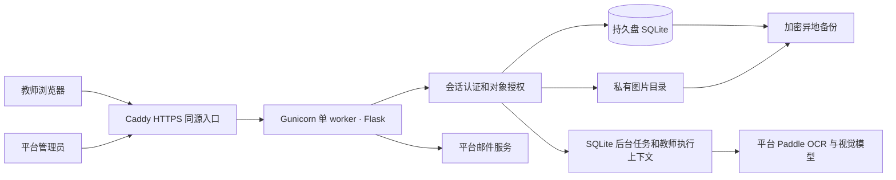

# MASTER-PLAN-01 · 默写本多教师在线化与正式部署

状态：规划待审核。审计基线为 GitHub 私有仓库 `kaiqixue/moxieben` 的 `main@3be0f2d1e5b1f9c1a078df3bd50b3b8e5bc2fc54`。通过已登录的 GitHub CLI 获取远端 SHA，并从对应 Git 对象读取源码与配置。另核对本机未提交的单教师登录变更。下文行号默认指远端基线。本轮为静态审计和方案设计。

## 1. 项目现状与审计结论

**结论：本地批改闭环已经具备，具备改造基础。多教师试用须先通过账号与会话、业务数据隔离、后台执行身份三道上线门槛。** 现有 OCR、评分、教师改判和导出可以复用。首批采用单应用实例和 SQLite，先用合成数据在杭州 ECS 验证。正式对外开放另需备案、域名、HTTPS 和真实数据处理验收。

| 范围 | 当前代码证据与上线影响 |
| --- | --- |
| 目录与运行 | 根目录 Flask 工厂由 `app.py:91 create_app` 创建，模块自行注册路由。首页等页面由 `app.py:422–435 index` 返回 Jinja 壳，`templates/index.html` 引入原生 JS/CSS。浏览器以相对路径访问同源 JSON 和 multipart。Excel、Word、PDF 和 HTML 由后端生成。无前端构建步骤，`start.ps1/start.bat` 属于本机开发启动。 |
| 依赖与启动配置 | `requirements.txt` 固定 Flask、Pillow、PaddlePaddle/PaddleOCR、Requests、openpyxl、defusedxml、python-docx 和 ReportLab。`start.ps1:2–6` 使用 Windows `.venv` 并提示 Python 3.11，生产镜像需验证这些包的 Linux 安装。`app.py:1197` 本机启动绑定 `127.0.0.1:5000`，关闭 debug 和自动重载。浏览器现用同源请求，源码未见 CORS 扩展或通配放行，生产沿用同源。 |
| 身份与入口 | `app.py:169 local_only` 限定本机 Host，写操作校验来源和进程级 CSRF。远端无登录用户、角色或所有权。现有归档和顺序控制为业务保护。生产 Host 受信任规则要重新配置。附录列出基线全部显式路由。 |
| 本机未提交变更 | `teacher_auth.py:44 register` 有单行 `teacher_account`、可撤销会话、单入口限速、登录退出和 CLI。测试及模板已在本机，远端尚无这些文件。可复用登录页、密码哈希、会话撤销与内部执行经验，仍需多用户、邮箱流程、角色、按来源限速和所有权。 |
| SQL 与关联 | `app.py:101 db` 启用 SQLite 外键，按请求连接并配置 30 秒等待。 `row:279` 按主键取行，`list_tasks:442`、`submission_summaries:365`、`class_management.py:228 list_classes/491 search_students` 缺教师范围。学生档案的 `school_code` 全局唯一，当前导入、关联和转班都在共享空间。 |
| 文件与图片 | `app.py:522 decode_photo` 校验 JPG/PNG、10 MiB 文件和 2500 万像素。上传以 UUID 存原图和展示 PNG，文件名写入数据库。批量上传 `batch_photos.py:269` 保留上传回执及去重。 `app.py:595/767`、`batch_photos.py:351`、`teacher_workbench.py:260` 按 ID 读文件。文件和下载需要和 JSON 同样的后端授权。批量上传目前在写事务中写盘并编码 PNG。 |
| 持久化路径 | `app.py:91–98 create_app` 默认在项目 `data/` 下创建 `dictation.sqlite3` 和 `uploads/`，支持通过 Flask 工厂配置覆盖 `DATA_DIR`。生产 WSGI 入口需显式把工厂配置指向持久卷，同时保存库和上传目录；当前 Windows 启动器仅用于 Local。 |
| 主 OCR 与评分 | `settings.py:45 recognize_selected` 选择本地、Paddle 云端或 OpenAI 兼容 OCR。`paddle_cloud.py:101 recognize` 提交、轮询、下载结果，未完成任务记录于 `cloud_ocr_jobs`。 `automatic_grading.py:121/162/250` 使用整页、局部补识别和评分，`answer_extraction.py` 对齐题号，`grading.py:10 compare` 严格判分。本地 OCR 按需加载 CPU 模型。 |
| 视觉复读 | 已在远端代码。 `settings.py:116/132` 独立配置、发送单题图、校验转录。 `app.py:699/733/784/892` 负责定位、排在计分后准备、保留建议和教师采纳。当前自动开关默认关闭，启用时每批最多尝试 8 题。现有记录无教师所有权。是否配置真实服务、实测准确率和成本未在本轮验证。 |
| 后台任务 | `grading_jobs.py:99–153/163–199/200–229/279` 使用 SQLite 保存状态和进度游标，单进程内守护线程顺序取任务。当前用 Flask `test_client` 和进程 CSRF 重入 HTTP 路由，任务无教师身份。启动把旧 queued/running 标为 interrupted，需显式继续。视觉建议是计分结束后的尽力执行步骤。 |
| 设置与秘密 | `settings.py:27/198–256` 将配置写入全局 SQLite 键值表，API Key/Token 等直接存为值，读取接口以布尔值隐藏密钥。配置修改和连通性测试当前只受原本机限制。Paddle 结果下载检查 HTTPS，未见固定结果域白名单。须改为平台管理与受控出站。 |
| 报表、删除与记忆 | `class_analysis.py:13/76/82` 聚合、下钻与下载讲评。任务和班级成绩分别从 `app.py:1112` 和 `class_management.py:660/674` 输出。`task_deletion.py:46` 删除前创建整库快照，不能让公网教师通过删除动作反复触发整库备份。 `name_memory.py:15/108` 记忆关联班级、学生和 JSON 来源照片。 |
| 学号栏及导入 | `student_id_band.py:22/85/111` 在作业保存模板快照并用已识别文字读学号。 `word_import.py:55/121` 解析题目/答案 Word，`class_management.py:360` 导入名单含预览和提交。解析和模板逻辑可复用，写入和读取均要带教师范围。 |
| 测试与部署准备 | 远端有 18 个 `test_*.py`、`requirements-dev.txt` 和 3 个浏览器相关脚本。覆盖匹配、OCR、批改、归档、导出及视觉复读，主要使用临时 SQLite 与模拟接口。真实 OCR / Word fixture 被排除，相关测试按文件是否存在跳过。现有部署文件为方案，远端没有 Dockerfile、Compose、生产 WSGI 入口或 GitHub Actions。 |

与旧文档的差异：旧方案以单机单教师或受控试点为起点，本计划以**开放注册和教师隔离**为正式目标。视觉复读已实现可选自动建议，仍需真实模型试点。杭州测试实例据项目方提供为 Ubuntu 22.04、4 核 8 GB、40 GB 系统盘。旧文档建议 24.04 LTS 与更宽裕的磁盘，后者是正式容量建议。服务器配置及账单未登录核验。

## 2. 目标架构和环境

- **Local** 使用开发配置和本机库。**Staging** 使用杭州试用 ECS、独立账号/数据卷/秘密/供应商额度，VPN 或 SSH 隧道加受限 HTTPS，仅虚构数据。**Production** 使用具备备案条件的实例、独立域名、密钥、数据卷、备份和运维访问边界。
- 保留 Flask 模板、原生 JS 和同源 API。业务请求、文件、导出及教师工作台均由 Flask 进行身份与对象授权。Caddy 只提供 HTTPS 入口与反向代理。静态文件可以由 Flask 从镜像提供。
- 部署操作细节沿用 [部署准备审计](DEPLOYMENT-AUDIT.md)、[部署架构](DEPLOYMENT-ARCHITECTURE.md)、[Compose 计划](DOCKER-DEPLOYMENT-PLAN.md)、[CI/CD 计划](GITHUB-CICD-PLAN.md)、[备份计划](DATABASE-AND-FILE-BACKUP.md)、[生产安全清单](PRODUCTION-SECURITY-CHECKLIST.md) 和 [资源估算](SERVER-RESOURCE-ESTIMATE.md)。本文件补充多教师差异，代码结论以本次固定提交为准。

## 3. 开放注册与账号

### 流程和角色

1. `GET/POST /teacher/register` 收教师姓名、邮箱、密码和确认密码。邮箱去首尾空白、规范化域名并按产品规则整体大小写不敏感，保留展示邮箱。不折叠加号或点别名。数据库唯一索引作为并发注册的最终判定，冲突走统一提示。
2. 服务端固定创建 `teacher`。注册完成即创建新会话并进入工作台，展示邮箱验证状态。可了解界面、建立班级、预备题目。完成邮箱验证和隐私提示后开放真实名册导入、图片上传、云模型和数据导出。邮箱验证属于证明邮箱可用，无邀请码或人工审批。
3. `/teacher/login` 支持邮箱和密码，`POST /teacher/logout` 撤销当前会话。统一错误文案和耗时策略，批准上线前为登录、注册、重发邮件和找回密码分别配置来源及账号限速。初始示例为每 IP 每小时 5 次注册，每邮箱 60 秒重发间隔及每小时 5 次，配置后依据压测和真实网络共享情况调整。人机验证仅在异常流量或阈值触发时弹出。
4. `platform_admin` 用服务器交互式 CLI 创建。管理员后台只提供账号状态、禁用/恢复、平台健康和脱敏用量。管理员不能调用教师业务 API，也不能代教师登录。启用管理员强密码及双因素作为上线门槛。学生端延期。

### 密码、会话和账号停用

- 新建 `users`（ID、展示姓名、邮箱及规范化唯一键、哈希、角色、验证和禁用状态）、`user_sessions`（用户 ID、随机令牌摘要、创建/过期/撤销等）、`account_tokens`（用户、用途、摘要、到期、已消费）、管理审计与必要的限速记录。数据库约束限制两种角色。迁移可复用本机 `teacher_auth.py` 的哈希与撤销思路，生产启动不得依赖测试模式。
- 教师密码沿用至少 8 字符的已确认产品决策，接受长口令并限制最大长度以控制资源，拒绝常见弱密码。使用带随机盐的自适应安全哈希，复用 Werkzeug scrypt 或采用经基准验证的等效实现。登录成功后轮换会话及 CSRF。HTTPS 使用 Secure、HttpOnly、SameSite=Lax 的会话 Cookie，服务端每次验证剩余时效和启用状态。初始最长 12 小时，空闲超时可配置。拒绝不安全的跳转目标。
- 修改密码需旧密码，找回密码通过已验证邮箱发一次性链接。邮箱验证和重置令牌只存摘要并区分用途，短有效期，消费与更新在同一事务。找回接口对不存在的账号使用相同响应。构造邮件链接使用配置的公共源站，避免取请求的 Host。重置、禁用立即撤销所有会话和未使用令牌。恢复账号后要求重新登录。
- 禁用教师时阻止新的请求和任务，暂停尚未执行的工作。正在发出的云请求无法撤回，结果落库前重新校验账号状态与资源归属，避免被禁用后继续生成正式结果。

## 4. 数据库改造与教师隔离

### 归属与约束

`owner_id` 指 `users.id` 中的教师，由后端根据会话或受信任务设置。根表使用 `NOT NULL` 与拥有者索引。使用复合外键的父表提供对应 `UNIQUE` 键。下表列出的冗余归属或任务字段仅用于阻挡跨对象写入，值始终与父级一致。

| 表 | 所有权与约束 | 主要改动 |
| --- | --- | --- |
| `classes`、`students`、`tasks` | 各自直接 `owner_id`，父级键 `(id,owner_id)` | 列表、搜索、写入都带教师；全局 `school_code UNIQUE` 改为 `UNIQUE(owner_id,school_code)`，保留同班学号规则。 |
| `class_memberships` | 从班级继承，冗余 `owner_id`；分别复合关联班级、学生 | 添加/编辑成员、转班和导入预览/提交均检查两端。 |
| `questions` | 通过任务继承，提供 `(id,task_id)` | 题目始终通过当前教师任务获取。 |
| `assignments` | 冗余 `owner_id`，分别复合关联班级、任务；提供 `(id,owner_id,task_id)` | 批量布置的所有 `class_ids` 在同一写事务验证，不允许一半成功；保留题卡快照、归档。 |
| `assignment_students` | 继承作业，保留 `owner_id/task_id` 作为约束键；作业三元组 FK、学生二元组 FK；提供 `(id,owner_id,task_id)` | 补充、免交、快照与成绩只能走自己作业。 |
| `submissions` | 直接 `owner_id` 由任务确定。复合关联任务和可空的 `assignment_student_id + owner_id + task_id`；提供 `(id,owner_id)`、`(id,task_id)` | 临时答卷也归教师。绑定名单仅可连接同一教师同一任务的记录，保留每名单一份有效答卷。 |
| `pages`、`ocr_runs` | 页继承答卷，OCR 记录继承页，页提供 `(id,submission_id)` | 先授权答卷，再读页、原图、旋转预览、OCR 数据。 |
| `batch_photos` | 从作业继承，冗余 `owner_id` 用于作业、关联答卷、建议名单的复合约束。可空的 `suggested_student_id` 指应交名单行 `assignment_students.id`，与同一作业共同校验。页与答卷复合关联 | 确认、改选与排除在同一事务验证照片、应交名单、答卷同作业。建议/候选 JSON 仅供提示，后端重新校验。 |
| `reviews`、`review_events` | `reviews` 增约束字段 `task_id`，分别复合链接答卷和题目；历史继承合法的答卷/题目对 | 改判和撤销检查作答、题目、页证据，历史不可按别人的事件 ID 拉取。 |
| `visual_suggestions`、`automatic_visual_attempts` | 继承合法答卷/题目对，复合关联 `(page_id,submission_id)` | 读取、采纳、裁图和重复尝试标记都归同一答卷，旧版本建议失效。 |
| `identity_memories` | 继承班级，冗余 `owner_id` 同时约束班级和学生 | 来源图片 JSON 在读写和删除时按班级作业链重验。 |
| `grading_jobs` | 显式 `owner_id`、`created_by_user_id`。作业或答卷是执行目标，两者之一为主锚点，复合 FK | 入队、查看、领取、推进及恢复都绑定教师，重验游标使用的 JSON ID。 |
| `cloud_ocr_jobs` | 增加 `owner_id`，并将其纳入请求去重/恢复键 | 同一图像指纹在不同教师下互不复用外部任务凭据。恢复时校验本次获准的源对象和配置。 |
| `settings` | 保留平台级非秘密配置，不设教师 owner | 教师普通权限不读写平台配置。按需提供不含内部 URL 的可用状态。 |

### 迁移策略

Staging 与首次 Production 默认使用新库。原本机教学数据继续留在本地。需要迁移时，单独审批并在停写窗口做 DB、图像与配置同一恢复点的备份。在隔离副本显式指定**经核对的目标教师**，用版本化迁移重建表、回填所有权与复合外键、记录校验结果。无归属、脏引用、历史 JSON 孤儿均阻断切换并人工处理。验证 `integrity_check`、`foreign_key_check`、记录和文件校验值、相同分数和历史、重复执行或中断恢复。原快照保留作为回滚点，禁止首个注册者领取旧数据。现有本地单账号的处理在账号方案执行时明确，优先新建并重新设置密码。

## 5. API、图片与后台任务

- **默认拒绝与统一权限。** 注册、登录、验证和找回接口及最小健康检查明确公开。未登录业务 API 返回 401，登录后角色不符返回 403，非本人对象统一返回 404。当前 `row` 只能做原始查找，新增面向教学数据的 `owned_row` 和按拥有者限定的列表/统计查询。所有路由显式分组。新增路由没声明权限时 CI 失败。
- **同一请求验证所有 ID。** 路径、JSON、查询参数、数组和数据库派生候选均要校验。将限制放进查询和写事务，不允许先全库查询再前端过滤。双重检查批量布置、转班、照片改选、局部裁图、改判及历史撤销中的不同对象关系。当前 `archived_assignment_read_only` 可保留归档规则，执行顺序置于认证与对象授权之后。
- **保护派生数据。** 文件只按授权后的记录名访问，存放于私有持久目录，规范化路径且拒绝越界；不向代理开放上传目录。照片、缩略/旋转图、复读裁图、讲评 HTML、报告、CSV/XLSX/PDF/Word 下载皆同权限、`no-store`。新增在线文件按租户目录存储，历史文件由受控迁移映射。报表只传必要结果，Excel/CSV 审查公式注入。
- **删除。** 普通教师的删除只触及本人目标记录和文件，并审计。现有 `task_deletion.py:66–71` 的整库快照换成平台自动备份与授权恢复操作，教师端提供回收期内可恢复的删除体验作为 P1。删除/清理至少需要配额、幂等、孤儿清理和事务失败测试。
- **任务身份。** 在入队时记录发起者、拥有者、任务范围。单 worker 将教师上下文传入同一套授权/业务函数，首期可用不可由 HTTP 构造的服务内标记携带已验证主体。标记只能跳过浏览器会话和 CSRF，不能免除教师、归属或账号启用状态校验。对写任务的流程设计以领域函数为目标，逐步去掉通过 test client 重入路由。
- **恢复和压力。** 保留 SQLite 游标、去重和手动继续，重启后任务标记中断且无静默重放。续跑重验身份、权限、范围、状态与云端请求历史。单实例按教师设活跃任务/暂存上限，限制并发文件解码和外部请求，批改大班不应无限霸占队列。云 OCR/视觉出错保持原状态与已有成绩，标明阶段和是否可重试。教师退出不取消已授权的批改。

## 6. OCR、视觉模型和原有功能兼容性

普通教师不能读取密钥、URL 或执行全局设置修改/连通测试。生产凭据采用运行环境的秘密文件和配置白名单，分别管理 Paddle 主 OCR、OpenAI 兼容主 OCR、视觉复读、SMTP。内部平台管理账号可读取脱敏状态，配置变更由授权运维渠道执行并记录。读取历史 settings 后默认不上载旧密钥，迁移需清除旧明文副本或轮换。出站仅支持核准 HTTPS 服务地址和 Paddle 结果下载域名，限制重定向、响应大小和时间，对地址解析结果与出口策略联动检查。

| 业务 | 可保留 | 必须变更/验证 |
| --- | --- | --- |
| 班级管理、学生导入 | 归档、名单预览、学号规范化、导入校验规则 | 查重、搜索、跨班转入和历史只对本人；越权 ID 无副作用。 |
| 作业创建、Word 导入、答题卡 | 导入解析、图片形式、题型、严格规则、PDF/Word 打印版式 | 任务/试题/作业与答题卡访问带归属；答案导入不得跨教师复用原件。 |
| 上传、整页 OCR、局部补识别 | 原图保留、裁图、已有 OCR 证据、识别失败重试 | 上传目录/配额、照片授权，平台配置、任务键及续跑隔离。 |
| 视觉复读、自动评分 | 模型转录、建议分和教师采纳，规则引擎不变 | 裁图与复读记录隔离，计费和每教师额度，明确哪些图片会送服务；异常状态正确。 |
| 人工改判、批改历史 | 原证据、教师标记、撤销及历史 | 每条记录带可追溯操作者，任何复读结果只能进入同一答卷；拒绝跨教师读写。 |
| 成绩统计、导出 | 工作台统计、错误分组、现有输出格式 | 汇总从拥有者过滤，CSV/XLSX/讲评/个人报告和图片统一访问策略。 |
| 后台任务恢复 | 进度游标、自恢复衔接、幂等规则 | 账号失效、教师归属、任务快照范围、多个老师上传和恢复各自独立。 |

向模型发送所需作答证据。视觉复读复用单题裁剪并避开可识别身份，主 OCR 图片可能含姓名与学号，须在首批真实使用前核对学校授权、提供商处理范围、保留和删除方式。提供面向老师的隐私提示及学生数据删除渠道。涉及未满十四周岁学生的个人信息，应在真实试用前核对适用规则和监护人同意要求。 [个人信息保护法，第二十八及三十一条](https://wb.flk.npc.gov.cn/flfg/PDF/f67af9f12e1b4c83a998cf5a876ce0e4.pdf)

## 7. 部署、备份和试用容量

**杭州测试 ECS。** 项目方提供 Ubuntu 22.04 x64、4 核 8 GB、40 GB ESSD Entry。可作为第一批合成数据容量验证的起点。采用 Docker Compose、Caddy、Gunicorn 一个 worker 和有限线程，绑定本地持久卷。Python 版本沿用 3.11 并锁定镜像摘要。云端 OCR 镜像可在验证后拆出本地 Paddle 大依赖，保留中文 PDF 字体包。宿主机安全更新，SSH 使用密钥及受限来源，后端容器端口仅内部可达。试用实例通过 VPN 或 SSH 隧道访问，不用它对互联网开放注册和真实学生数据。 [Flask Gunicorn 说明](https://flask.palletsprojects.com/en/stable/deploying/gunicorn/) · [阿里云 ECS 试用说明](https://help.aliyun.com/zh/ecs/user-guide/ecs-free-trial)

**正式上线。** 另选在控制台确认支持备案的实例。准备实名认证且主体相符的域名、接入资料和 ICP 备案，并核对适用的公安备案、经营性要求及隐私规则。完成相应手续后配置 DNS 和 Caddy HTTPS，验证证书续期、受信代理头、Secure Cookie、登录及上传。HTTPS 是传输保护，备案资格以服务商与主管部门要求为准。 [阿里云备案条件与流程](https://help.aliyun.com/zh/icp-filing/basic-icp-service/support/for-the-record-process-faq) · [域名核验](https://help.aliyun.com/zh/icp-filing/basic-icp-service/user-guide/prepare-and-check-the-domain-name) · [Caddy 自动 HTTPS](https://caddyserver.com/docs/automatic-https)

**配置与更新。** Local、Staging 和 Production 各自使用独立域名、卷、会话密钥、模型和邮件凭据。GitHub 保持私有，PR 做静态检查、合成数据回归和镜像扫描。Staging 验收通过的镜像摘要供 Production 手动发布。启动探活仅报告最少状态，完整诊断限管理侧。统一结构化日志记录错误阶段、耗时、队列和脱敏标识，轮转并告警，不记录图片、作答、密码及供应商凭据。维护窗口停止新写入，排空任务后发布，支持按旧镜像和同恢复点备份回滚。详细步骤沿用 [Compose](DOCKER-DEPLOYMENT-PLAN.md) 与 [CI/CD](GITHUB-CICD-PLAN.md) 文档。

**容量判断。** 以首批 5–10 位测试老师、2 位同时上传、每位一班 50 张作为压测起点，是否适合实用取决于出入站带宽、云 OCR 配额、单线程队列和磁盘增长。报名人数不能直接换算成可并行批改班数。按图片文件及其 PNG 共 6 MiB/张的**估值**，100 张约 600 MiB，20 班批次约 5.9 GiB，另加数据库、镜像、临时文件和备份。测试盘 40 GB 可以开始，建议监控 70% 预警、80% 停止扩量，正式数据盘按实际月上传数、保留周期与实测每张 p95 单独配置。已有测算方法见 [服务器资源估算](SERVER-RESOURCE-ESTIMATE.md)。

**SQLite 保留条件。** 单实例、宿主机本地持久盘，短写事务并测量锁等待。缩短 `batch_photos.py:294–307` 的写锁持有时间，图片解码/编码在事务外准备，落库和文件替换保持可恢复。若有必要，在 Staging 评估 WAL 及备份恢复。达到试用并发仍出现持续 `SQLITE_BUSY`、写等待超过验收目标，或必须多主机/高可用时，再评估 PostgreSQL 与相应队列和文件存储。不在首期加入 Redis、Celery 或 Kubernetes。 [SQLite 选型指导](https://www.sqlite.org/whentouse.html) · [SQLite WAL](https://sqlite.org/wal.html)

**备份与恢复。** 保留 SQLite Backup API、图片及配置同恢复点组合的现有方案。默认每日备份与发版前备份，保留最近 7 日、4 周、3 月，独立异地加密存放。RPO 24 小时、RTO 4 小时作为首批目标，演练后确认。密钥独立备份，不与普通数据归档混放。恢复到隔离目录验证外键、各教师记录数、文件摘要、分数和历史，禁止将生产数据导入常规 Staging。按角色审批恢复，测试回滚后的登录、文件和队列。 [备份与保留计划](DATABASE-AND-FILE-BACKUP.md) · [SQLite Backup API](https://www.sqlite.org/backup.html)

## 8. 测试与产品验收

面向两位虚构教师 A/B、一个平台管理员和一个未登录浏览器。测试图片和文档用程序生成，常规用例模拟 OCR/VLM/邮件服务。另用合成图做受控云端连通性和费用验证。以下为待执行计划。

| 编号 | 验收内容 | 可复核的通过标准 |
| --- | --- | --- |
| QA-A 账号 | 开放注册、重复规范化邮箱及同时注册、恶意角色值、登录失败、会话过期、撤销、禁用、验证与重置 | 注册自动进入教师工作台；重复邮箱只有一条账号；角色不可由请求提升；旧密码/令牌/会话失效；源站安全；速率超过门槛有可理解反馈。 |
| QA-B 隔离 | 互换班级、学生、作业、题目、提交、图片/预览/裁图、分数、导出、历史、队列、记忆及授权令牌 | A/B 双向测试 GET/写入/删除及批量混合 ID。跨教师 404 或明确角色 403，响应无他人数据且数据库、文件和 AI 调用无副作用。管理员同样无法查看教学数据。 |
| QA-C 教学闭环 | A/B 分别注册后建班、导入虚构学生、建任务、上传多页、OCR、自动计分、手动改判、历史、讲评、成绩导出 | 两人均能独立完成。Word 导入、模板、免交/归档、临时答卷、重试不重复计分等保留。用基线作答比较材料、转录和分数。 |
| QA-D 稳定与恢复 | 两教师并发登录上传、网络中断、磁盘不足、OCR/VLM超时/额度、邮件故障、任务恢复、重启及备份 | 普通操作保持可用，失败有原因和明确恢复入口，成绩/原图不丢失，重启不重复发已知外部请求。DB 与照片从同一时间点恢复。 |
| QA-E 发布与无障碍 | 390/900/1440px，键盘、登录回跳、会话过期反馈、HTTPS 与安全头、开关注册、回滚、正反代理检查 | 只公开所需端口与最小探活，证书和域名通过验收。回滚不把新数据静默丢弃。 |

容量初验用两份各 50 张合成照片，记录登录/查询保护范围、上传失败率、P95 写等待、批次时延、进程 RSS、磁盘、网络和外部调用数。试用建议无 OOM、无跨教师访问、无重复有效批改、无非预期 SQLite 锁错及充值额度意外。除识别等待外的常用查询初始目标 P95 不超过 2 秒，整班阈值根据杭州实际网络、OCR 延时和项目方可接受等待核定。功能、隔离及恢复验证是放量门槛。

## 9. 九阶段实施路线图

优先级定义：P0 是安全或正式使用的阻塞项，P1 是试用可靠性与运维要求，P2 是依据反馈追加。阶段二与三允许独立拆 PR，线上注册开关在所有上线门槛通过前保持关闭。

| 阶段与任务 | 目标、预计文件及改动 | 前置与风险 | 测试和验收 | 完成后的下一步 |
| --- | --- | --- | --- | --- |
| 一 · MP-01 P0 现有项目审计 | 固定 GitHub SHA、检查现有登录差异、表/路由/模型链，交付本文件 | 需私有库只读权限。风险为混淆远端与本机实现 | 路由完整清单、数据归属图谱、阻塞项、备份/部署索引可复核 | 审核账号、隔离策略及范围 |
| 二 · MP-02 P0 账号与开放注册 | 基于本机 `teacher_auth.py` 的已有代码审查整合，新增 `accounts.py` 或扩展现有模块、登录/注册模板与 `test_accounts.py`。加入账户、角色、会话、邮箱验证、限速、管理 CLI | MP-01 通过。邮件、秘密、滥用。真实开放仍受隔离与上线门槛限制 | QA-A 全过。新教师自动进入受保护工作台。管理员初始化仅服务器 CLI | 启动所有权迁移及资源守卫 |
| 三 · MP-03 P0 教师隔离 | `app.py`、`class_management.py`、`batch_photos.py`、`teacher_workbench.py`、`name_memory.py`、`class_analysis.py`、`task_deletion.py`。引入按教师查询、复合约束、图片和导出保护、版本迁移 | MP-02 提供真实用户 ID；先拿合成旧结构演练。风险为漏掉列表、跨对象写与 JSON 引用 | QA-B 全过；跨教师试验前后 DB/文件/调用无副作用。旧副本校验通过 | 接任务所有权与跨模块回归 |
| 四 · MP-04 P0 业务兼容 | `grading_jobs.py`、`automatic_grading.py`、`settings.py`、`paddle_cloud.py` 及测试。执行上下文、配置权限、云恢复、异常语义与配额 | MP-03；管理员不得临时充当全局教师。首调用失败或重复费用 | QA-C 与 QA-D 中断项全过，A/B 分别完成流程，视觉不可用时仍能改判和导出 | 冻结可构建候选 |
| 五 · MP-05 P0 容器准备 | 新增 `Dockerfile`、`compose.yaml`、生产 WSGI 入口、Caddy 配置、`.env.example` 及 Actions。单 worker、同源、私有卷、secret 文件 | MP-04 基线，Linux 镜像包和字体需核验。风险为 secrets 注入错误、路径不同、误开公网 | CI、镜像扫描、私有 GHCR、中文打印和持久卷回归通过，可按摘要重复安装和回滚 | 部署候选到隔离测试服务器 |
| 六 · MP-06 P1 阿里云 Staging | 依据 [Compose 计划](DOCKER-DEPLOYMENT-PLAN.md) 初始化现有 ECS。受限入口、独立卷、模拟识别及合成图，采集负载指标 | MP-05、服务器操作另行批准。风险为 40 GB 盘和试用到期、VLM 网络可达性 | QA-C、QA-D 在 ECS 完整执行，记录两班并发、资源与恢复证据。公网业务入口关闭 | 提交安全和容量报告 |
| 七 · MP-07 P0 安全与功能验收 | 执行 `test_accounts.py`、`test_tenant_isolation.py`、端到端浏览器与 [安全清单](PRODUCTION-SECURITY-CHECKLIST.md) | MP-06。重点为新路由遗漏、越权、误调真实 API | QA-A 至 QA-E 全通过，恢复与回滚演练成功，产品/运维负责人确认 | 确认正式资源和上线窗口 |
| 八 · MP-08 P0 域名备案与上线 | 用独立正式环境部署验收摘要，配置 DNS、备案和 HTTPS。依赖环境配置与运行文档，无新业务架构 | MP-07，域名/备案/服务商条款、正式密钥、数据处理条款通过。在配置无疑义前不接受公网真数据 | 正式域名访问、注册、登录和隔离冒烟通过，证书、告警、恢复点和关闭注册开关就绪 | 产品负责人批准少量试用 |
| 九 · MP-09 P1/P2 教师体验与迭代 | 首批邀请仅为体验沟通，网站注册仍开放。记录首次完成率、核对用时、服务失败及额度。反馈再形成独立 PR | MP-08 与学校授权。试点反馈不得包含原图或个人信息 | 非开发教师可独立完成闭环，支持路径清楚，达成容量目标后逐批放量 | 优先修复阻塞，再考虑角色扩展、续跑自动化或数据库升级 |

## 10. 风险和决策门槛

| 优先级 | 风险与证据 | 缓解与放行条件 |
| --- | --- | --- |
| P0 | 单机 API 按 ID 访问、全局列表，泄露其他老师数据 | 按对象与全链条授权，复合外键和 A/B 互换测试覆盖全部路由。 |
| P0 | 云端任务、复读和续跑缺少租户上下文，可能误读或写错答卷 | 队列保存身份、范围及去重键，每次推进或写回重验。 |
| P0 | 开放注册带来刷号、验证码/邮件和 OCR 成本 | 邮箱验证、限速、教师额度、平台总额度和报警，先用合成数据测。 |
| P0 | 设置与备份可能包含全局密钥及学生数据 | 权限隔离、外置秘密、日志脱敏、加密备份、恢复演练。临时导出/原始文件只在本人可访问的范围。 |
| P0 | 历史数据误绑定或恢复错位 | 新库优先，旧库显式所有者迁移，先验证外键与文件，再发版。 |
| P0 | 使用不具备案条件实例上线，或真实学生数据处理未经确认 | Staging 受限且合成。正式备案与数据处理验收分别把关。 |
| P1 | 步骤串行造成排队，磁盘增长、锁冲突和 OCR 失败 | 监控/配额/回收，缩短写事务。按压测结果设并发和放量。 |
| P2 | 普通题误报增加工作量，或过早引入架构复杂度 | 继续严格规则评分，视觉建议先收集准确率和操作时长，按证据扩展。 |

## 11. 下一项真正开始编码的任务

**MP-02A。** 先在新分支审查本机单教师登录，以其为基础实现 `users + user_sessions`、服务器管理员初始化、教师邮箱注册/登录/退出与最小认证测试，配合默认关闭的对外注册开关。第一条测试用例验证带 `role=platform_admin` 的注册仍只能获得 `teacher`。第二条验证两个浏览器可以各自登录，停用/重置后旧会话不可用。随后立即实施 MP-03，登录做完也不能向多位教师开放现有教学数据。

距多教师在线使用的关键路径是 MP-02 → MP-03 → MP-04 → MP-05/06 → MP-07。当前没有足够的开发和压测数据给出可靠上线日期。4 核 8 GB 足以启动首批合成数据试用和容量验证，SQLite 与现有 PaddleOCR/视觉模式继续用。实际公网开放取决于租户与恢复验收、模型/邮件外联、容量和备案。待负责人审核后开始。

## 附录 A · 远端显式路由清单

下表由固定 SHA 中 Flask 路由装饰器生成。Flask 自动添加的 HEAD、OPTIONS 和静态资源不重复列出。统一现状是本机 Host 门槛及全局写请求 CSRF，没有教师会话或租户检查。计划列标记每组必须验证的主体，涉及多个对象及导出的细则见第 5 节。

共 90 个显式方法与路径。

| 方法与路径 | GitHub 基线位置 | 上线前权限要求 |
|---|---|---|
| GET `/` | `app.py:422` · `index` | 教师会话，页面数据 API 再验归属 |
| GET `/tasks` | `app.py:423` · `index` | 教师会话，页面数据 API 再验归属 |
| GET `/tasks/new` | `app.py:424` · `index` | 教师会话，页面数据 API 再验归属 |
| GET `/tasks/<int:record_id>` | `app.py:425` · `index` | 教师会话，页面数据 API 再验归属 |
| GET `/submissions/<int:record_id>` | `app.py:426` · `index` | 教师会话，页面数据 API 再验归属 |
| GET `/classes` | `app.py:427` · `index` | 教师会话，页面数据 API 再验归属 |
| GET `/classes/<int:record_id>` | `app.py:428` · `index` | 教师会话，页面数据 API 再验归属 |
| GET `/assignments` | `app.py:429` · `index` | 教师会话，页面数据 API 再验归属 |
| GET `/assignments/<int:record_id>` | `app.py:430` · `index` | 教师会话，页面数据 API 再验归属 |
| GET `/assignments/<int:record_id>/analysis` | `app.py:431` · `index` | 教师会话，页面数据 API 再验归属 |
| GET `/settings` | `app.py:432` · `index` | 教师会话，页面数据 API 再验归属 |
| GET `/students/<int:record_id>` | `app.py:433` · `index` | 教师会话，页面数据 API 再验归属 |
| GET `/api/health` | `app.py:437` · `health` | 公开最少探活信息 |
| GET `/api/tasks` | `app.py:441` · `list_tasks` | 教师自己的任务及关联数据；创建或导入绑定当前教师 |
| POST `/api/tasks/import-word` | `app.py:456` · `import_word` | 教师自己的任务及关联数据；创建或导入绑定当前教师 |
| POST `/api/tasks` | `app.py:468` · `new_task` | 教师自己的任务及关联数据；创建或导入绑定当前教师 |
| GET `/api/tasks/<int:tid>` | `app.py:502` · `get_task` | 教师自己的任务及关联数据；创建或导入绑定当前教师 |
| POST `/api/tasks/<int:tid>/submissions` | `app.py:507` · `new_submission` | 教师自己的任务及关联数据；创建或导入绑定当前教师 |
| GET `/api/submissions/<int:sid>` | `app.py:517` · `get_submission` | 教师自己的答卷及其任务、题目或批改记录 |
| POST `/api/submissions/<int:sid>/pages` | `app.py:543` · `upload` | 教师自己的答卷及其任务、题目或批改记录 |
| POST `/api/pages/<int:pid>/reviewed` | `app.py:579` · `acknowledge_page` | 教师自己的页及其父答卷 |
| GET `/api/pages/<int:pid>/image` | `app.py:594` · `get_image` | 教师自己的页及其父答卷 |
| POST `/api/pages/<int:pid>/ocr` | `app.py:600` · `run_ocr` | 教师自己的页及其父答卷 |
| GET `/api/submissions/<int:sid>/visual-suggestions/<int:vid>/image` | `app.py:766` · `visual_suggestion_image` | 教师自己的答卷及该答卷的建议和裁图 |
| POST `/api/submissions/<int:sid>/reviews/<int:qid>/visual-reread` | `app.py:783` · `visual_reread` | 教师自己的答卷及其任务、题目或批改记录 |
| POST `/api/submissions/<int:sid>/reviews/<int:qid>` | `app.py:891` · `save_review` | 教师自己的答卷及其任务、题目或批改记录 |
| POST `/api/submissions/<int:sid>/reviews/<int:qid>/undo` | `app.py:980` · `undo_quick_review` | 教师自己的答卷及其任务、题目或批改记录 |
| GET `/api/submissions/<int:sid>/suggestions` | `app.py:1010` · `suggestions` | 教师自己的答卷及其任务、题目或批改记录 |
| POST `/api/submissions/<int:sid>/extract-answers` | `app.py:1074` · `extract_answers` | 教师自己的答卷及其任务、题目或批改记录 |
| GET `/tasks/<int:tid>/grades.csv` | `app.py:1111` · `grades` | 教师自己的任务及关联数据；创建或导入绑定当前教师 |
| GET `/tasks/<int:tid>/sheet` | `app.py:1131` · `sheet` | 教师自己的任务及关联数据；创建或导入绑定当前教师 |
| GET `/tasks/<int:tid>/answer-card` | `app.py:1137` · `answer_card` | 教师自己的任务及关联数据；创建或导入绑定当前教师 |
| GET `/tasks/<int:tid>/answer-card/download` | `app.py:1138` · `answer_card` | 教师自己的任务及关联数据；创建或导入绑定当前教师 |
| GET `/assignments/<int:aid>/answer-card` | `app.py:1139` · `answer_card` | 教师自己的班级作业及其名单或导出 |
| GET `/assignments/<int:aid>/answer-card/download` | `app.py:1140` · `answer_card` | 教师自己的班级作业及其名单或导出 |
| GET `/submissions/<int:sid>/report` | `app.py:1169` · `report` | 教师自己的答卷及其任务、题目或批改记录 |
| GET `/api/submissions/<int:sid>/history` | `app.py:1175` · `history` | 教师自己的答卷及其任务、题目或批改记录 |
| POST `/api/submissions/<int:sid>/auto-grade` | `automatic_grading.py:249` · `auto_grade` | 教师自己的答卷及其任务、题目或批改记录 |
| POST `/api/assignments/<int:aid>/photos` | `batch_photos.py:268` · `upload_batch_photos` | 教师自己的班级作业及其名单或导出 |
| GET `/api/assignments/<int:aid>/photos` | `batch_photos.py:326` · `list_batch_photos` | 教师自己的班级作业及其名单或导出 |
| GET `/api/batch-photos/<int:pid>` | `batch_photos.py:333` · `batch_photo_detail` | 照片和所属作业；确认、改选时同时核验目标名单 |
| POST `/api/assignments/<int:aid>/photos/match` | `batch_photos.py:338` · `match_batch_photos` | 教师自己的班级作业及其名单或导出 |
| GET `/api/batch-photos/<int:pid>/image` | `batch_photos.py:350` · `batch_photo_image` | 照片和所属作业；确认、改选时同时核验目标名单 |
| POST `/api/batch-photos/<int:pid>/exclude` | `batch_photos.py:356` · `exclude_photo` | 照片和所属作业；确认、改选时同时核验目标名单 |
| POST `/api/batch-photos/<int:pid>/identify` | `batch_photos.py:377` · `identify_batch_photo` | 照片和所属作业；确认、改选时同时核验目标名单 |
| POST `/api/batch-photos/<int:pid>/confirm` | `batch_photos.py:425` · `confirm_batch_photo` | 照片和所属作业；确认、改选时同时核验目标名单 |
| POST `/api/batch-photos/<int:pid>/reassign` | `batch_photos.py:516` · `reassign_photo` | 照片和所属作业；确认、改选时同时核验目标名单 |
| GET `/api/assignments/<int:aid>/analysis` | `class_analysis.py:75` · `class_analysis_json` | 教师自己的班级作业及其名单或导出 |
| GET `/assignments/<int:aid>/analysis/download` | `class_analysis.py:81` · `class_analysis_page` | 教师自己的班级作业及其名单或导出 |
| POST `/api/assignments/<int:aid>/answer-card-format` | `class_management.py:187` · `save_answer_card_format` | 教师自己的班级作业及其名单或导出 |
| GET `/api/classes` | `class_management.py:227` · `list_classes` | 教师自己的班级，导入或增员时学生归属一致 |
| POST `/api/classes` | `class_management.py:236` · `create_class` | 教师自己的班级，导入或增员时学生归属一致 |
| GET `/api/classes/<int:cid>` | `class_management.py:245` · `get_class` | 教师自己的班级，导入或增员时学生归属一致 |
| PATCH `/api/classes/<int:cid>` | `class_management.py:250` · `update_class` | 教师自己的班级，导入或增员时学生归属一致 |
| POST `/api/classes/<int:cid>/members` | `class_management.py:273` · `create_member` | 教师自己的班级，导入或增员时学生归属一致 |
| PATCH `/api/members/<int:mid>` | `class_management.py:280` · `update_member` | 教师自己的成员、学生及涉及的全部班级 |
| POST `/api/members/<int:mid>/transfer` | `class_management.py:294` · `transfer_member` | 教师自己的成员、学生及涉及的全部班级 |
| POST `/api/classes/<int:cid>/import` | `class_management.py:359` · `import_members` | 教师自己的班级，导入或增员时学生归属一致 |
| GET `/api/students` | `class_management.py:490` · `search_students` | 教师自己的学生及其关联数据 |
| GET `/api/students/<int:sid>` | `class_management.py:498` · `get_student` | 教师自己的学生及其关联数据 |
| PATCH `/api/students/<int:sid>` | `class_management.py:525` · `update_student` | 教师自己的学生及其关联数据 |
| POST `/api/tasks/<int:tid>/assignments` | `class_management.py:544` · `create_assignments` | 教师自己的任务及请求中的全部班级 |
| GET `/api/assignments/<int:aid>` | `class_management.py:566` · `get_assignment` | 教师自己的班级作业及其名单或导出 |
| PATCH `/api/assignments/<int:aid>` | `class_management.py:571` · `set_assignment_archive` | 教师自己的班级作业及其名单或导出 |
| POST `/api/assignments/<int:aid>/students` | `class_management.py:584` · `append_assignment_student` | 教师自己的班级作业名单、学生和关联答卷 |
| PATCH `/api/assignment-students/<int:rid>` | `class_management.py:601` · `exempt_student` | 教师自己的班级作业名单、学生和关联答卷 |
| POST `/api/assignment-students/<int:rid>/submission` | `class_management.py:613` · `roster_submission` | 教师自己的班级作业名单、学生和关联答卷 |
| POST `/api/submissions/<int:sid>/link` | `class_management.py:630` · `link_submission` | 教师自己的答卷和目标名单，任务一致 |
| GET `/assignments/<int:aid>/grades.csv` | `class_management.py:659` · `assignment_grades` | 教师自己的班级作业及其名单或导出 |
| GET `/assignments/<int:aid>/grades.xlsx` | `class_management.py:673` · `assignment_grades_xlsx` | 教师自己的班级作业及其名单或导出 |
| GET `/api/grading-jobs/<int:jid>` | `grading_jobs.py:23` · `get_grading_job` | 教师自己的任务，重验关联作业和全部处理项 |
| GET `/api/assignments/<int:aid>/grading-jobs` | `grading_jobs.py:28` · `latest_grading_job` | 教师自己的照片、答卷或班级作业，绑定任务归属 |
| POST `/api/assignments/<int:aid>/grading-jobs` | `grading_jobs.py:35` · `start_grading_job` | 教师自己的照片、答卷或班级作业，绑定任务归属 |
| POST `/api/batch-photos/<int:pid>/process` | `grading_jobs.py:44` · `process_photo` | 教师自己的照片、答卷或班级作业，绑定任务归属 |
| GET `/api/submissions/<int:sid>/grading-jobs` | `grading_jobs.py:55` · `submission_job` | 教师自己的照片、答卷或班级作业，绑定任务归属 |
| POST `/api/submissions/<int:sid>/grading-jobs` | `grading_jobs.py:62` · `start_submission_job` | 教师自己的照片、答卷或班级作业，绑定任务归属 |
| POST `/api/grading-jobs/<int:jid>/resume` | `grading_jobs.py:72` · `resume_grading_job` | 教师自己的任务，重验关联作业和全部处理项 |
| GET `/api/classes/<int:cid>/identity-memories` | `name_memory.py:123` · `memories` | 教师自己的班级，核验学生、记忆及来源照片归属 |
| GET `/api/classes/<int:cid>/identity-memories/candidates` | `name_memory.py:129` · `candidates` | 教师自己的班级，核验学生、记忆及来源照片归属 |
| POST `/api/classes/<int:cid>/identity-memories` | `name_memory.py:144` · `import_memory` | 教师自己的班级，核验学生、记忆及来源照片归属 |
| PATCH `/api/classes/<int:cid>/identity-memories/<int:mid>` | `name_memory.py:160` · `update_memory` | 教师自己的班级，核验学生、记忆及来源照片归属 |
| GET `/api/settings` | `settings.py:201` · `get_settings` | 平台管理员，教师另有脱敏状态摘要 |
| PATCH `/api/settings` | `settings.py:205` · `update_settings` | 平台管理员，逐次验权和审计 |
| POST `/api/settings/test` | `settings.py:241` · `test_settings` | 平台管理员，逐次验权和审计 |
| GET `/api/tasks/<int:tid>/deletion-preview` | `task_deletion.py:40` · `deletion_preview` | 教师自己的任务及级联对象，删除受控 |
| DELETE `/api/tasks/<int:tid>` | `task_deletion.py:45` · `delete_task` | 教师自己的任务及级联对象，删除受控 |
| GET `/api/workbench/assignments` | `teacher_workbench.py:195` · `workbench_assignments` | 教师自己的班级作业汇总 |
| GET `/api/assignments/<int:aid>/attention` | `teacher_workbench.py:244` · `assignment_attention` | 教师自己的班级作业及其名单或导出 |
| GET `/api/tasks/<int:tid>/attention` | `teacher_workbench.py:251` · `task_attention` | 教师自己的任务及关联数据；创建或导入绑定当前教师 |
| GET `/api/pages/<int:pid>/preview` | `teacher_workbench.py:259` · `page_preview` | 教师自己的页及其父答卷 |
